# Laboratory Work No. 1 — Creational Design Patterns

**Technical University of Moldova**
Faculty of Computers, Informatics and Microelectronics
Department of Software Engineering and Automation

| | |
|---|---|
| **Discipline** | Techniques and Mechanisms of Software Design (TMPS) |
| **Topic** | Creational Design Patterns (Singleton, Builder, Factory Method) |
| **Done by** | st. gr. FAF-243, Augustin Carazanu |
| **Checked by** | assist. univ. Daniel Istrati |
| **Year** | Chișinău, 2026 |

---

## Table of contents

1. [Objectives](#1-objectives)
2. [Theoretical background](#2-theoretical-background)
3. [Implementation](#3-implementation)
   - [3.1 Singleton — OrderNumberGenerator](#31-singleton--ordernumbergenerator)
   - [3.2 Builder — OrderBuilder and OrderDirector](#32-builder--orderbuilder-and-orderdirector)
   - [3.3 Factory Method — DeliveryService](#33-factory-method--deliveryservice)
4. [Testing and results](#4-testing-and-results)
5. [The other creational patterns](#5-the-other-creational-patterns)
6. [Conclusion](#conclusion)
7. [Bibliography](#bibliography)

---

## 1. Objectives

- Study the creational design patterns: Singleton, Builder, Prototype, Object Pool, Factory Method and Abstract Factory.
- Implement three of them in one Swift project: **Singleton**, **Builder** and **Factory Method**.
- Show, through a demo program and unit tests, what problem each pattern solves, and know the purpose and structure of the other three.

## 2. Theoretical background

Design patterns are reusable solutions to problems that keep appearing in object-oriented design. They were catalogued by Gamma, Helm, Johnson and Vlissides (the "Gang of Four", 1994) and divided into **creational**, **structural** and **behavioral** patterns.

**Creational patterns** deal with how objects are created. Instead of calling an initializer directly everywhere, the creation logic is placed behind a dedicated class, method or interface. This hides which concrete class is used, controls how many instances exist and how they are assembled, and keeps client code independent of these decisions.

| Pattern | Intent | Typical use |
|---|---|---|
| **Singleton** | Ensure a class has exactly one instance and give a global access point to it. | Shared counters, configuration, logger, cache. |
| **Builder** | Construct a complex object step by step; the same process can create different representations. | Objects with many optional parts, immutable results, validation before creation. |
| **Prototype** | Create new objects by copying an existing, configured instance. | Expensive setup, many similar objects, runtime-defined templates. |
| **Object Pool** | Reuse a fixed set of expensive objects instead of creating and destroying them. | Database connections, threads, network sockets. |
| **Factory Method** | Define a method for creating an object, but let subclasses (conforming types) decide which class to instantiate. | A framework that knows *when* to create, but not *what* exactly. |
| **Abstract Factory** | Provide an interface for creating families of related objects without naming their concrete classes. | UI themes, cross-platform widgets, product families. |

This laboratory work implements **Singleton**, **Builder** and **Factory Method**. **Prototype**, **Object Pool** and **Abstract Factory** are explained with short Swift examples in [section 5](#5-the-other-creational-patterns).

## 3. Implementation

The project continues the online bookstore domain from the previous laboratory work. It is a Swift Package with three targets:

| Target | Role |
|---|---|
| `CreationalCore` | Library containing the patterns |
| `CreationalDemo` | Executable that shows the patterns working together |
| `CreationalTests` | XCTest unit tests |

```
lab1/
├── Package.swift
├── Sources/
│   ├── CreationalCore/
│   │   ├── Models.swift
│   │   ├── Singleton/      OrderNumberGenerator.swift
│   │   ├── Builder/        Order.swift  OrderBuilder.swift
│   │   └── FactoryMethod/  Shipment.swift  DeliveryService.swift
│   └── CreationalDemo/main.swift
└── Tests/CreationalTests/CreationalTests.swift
```

The three patterns cooperate: the **Builder** creates orders and takes their numbers from the **Singleton**, and the **Factory Method** decides how each order is delivered.

#### Diagram — how the three patterns cooperate

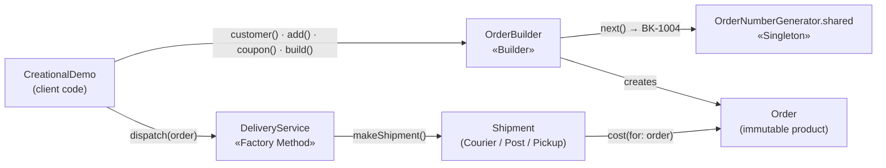


```swift
/// A book sold by the online bookstore.
public struct Book: Equatable {
    public let title: String
    public let author: String
    public let price: Double
}

/// Formats an amount as "123.45 MDL".
public func money(_ amount: Double) -> String {
    String(format: "%.2f MDL", amount)
}
```

### 3.1 Singleton — OrderNumberGenerator

📄 [`Sources/CreationalCore/Singleton/OrderNumberGenerator.swift`](../Sources/CreationalCore/Singleton/OrderNumberGenerator.swift)

**Problem.** Every order needs a unique number. If the checkout screen and the admin panel each created their own generator, both counters would start at 1001 and the shop would issue duplicate order numbers. The generator must exist exactly once and be reachable from every part of the application.

**Solution.** `OrderNumberGenerator` exposes its only instance through `static let shared`. In Swift a static stored property is initialized lazily, once and thread-safely, so no double-checked locking is needed. The initializer is `private`, which makes `OrderNumberGenerator()` a compile-time error outside the class. Because `next()` can be called from several threads at once, the counter is protected with an `NSLock`.

```swift
public final class OrderNumberGenerator {

    /// The one and only instance.
    public static let shared = OrderNumberGenerator()

    public let prefix = "BK"
    private var lastNumber = 1000
    private let lock = NSLock()

    /// Private: `OrderNumberGenerator()` does not compile outside this class.
    private init() {}

    /// Returns the next unique order number, e.g. "BK-1001".
    public func next() -> String {
        lock.lock()
        defer { lock.unlock() }
        lastNumber += 1
        return "\(prefix)-\(lastNumber)"
    }
}
```

#### Diagram — Singleton class structure

`shared` is static (underlined) and `init()` is private (`-`), so every client goes through the same instance.

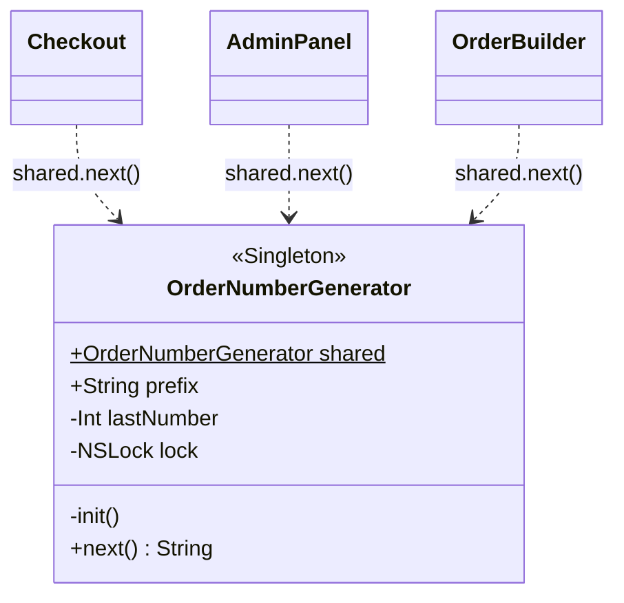

#### Diagram — Singleton at runtime

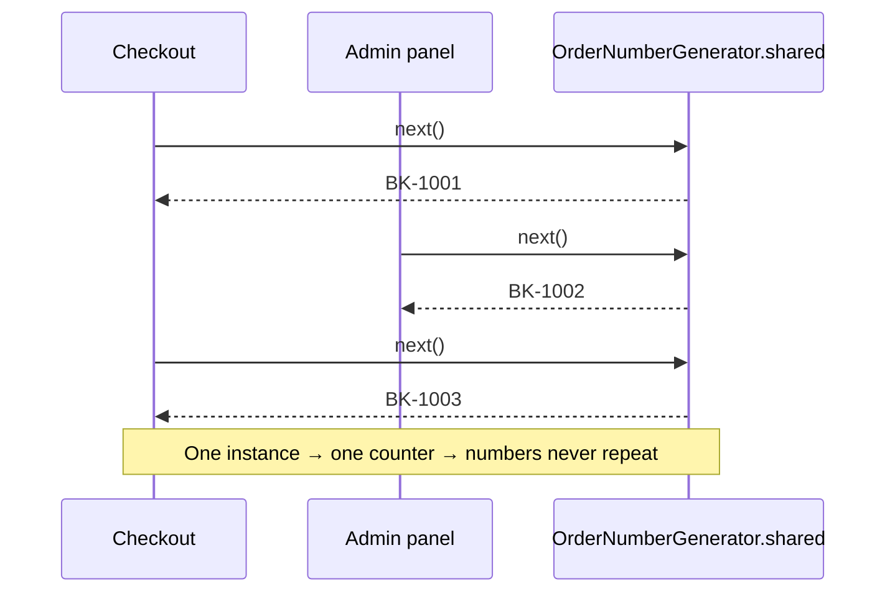


> **Drawback.** A Singleton is global state. Code that uses `OrderNumberGenerator.shared` directly is harder to test in isolation. In larger systems the instance is usually injected through a protocol, which is the Dependency Inversion Principle from the previous laboratory work.

### 3.2 Builder — OrderBuilder and OrderDirector

📄 [`Sources/CreationalCore/Builder/Order.swift`](../Sources/CreationalCore/Builder/Order.swift) · [`Sources/CreationalCore/Builder/OrderBuilder.swift`](../Sources/CreationalCore/Builder/OrderBuilder.swift)

**Problem.** An order has two required parts (customer and books) and many optional ones: shipping address, gift wrapping, gift message, coupon and notes. A single initializer would require eight arguments, most of them `nil` or `false` (the "telescoping constructor" problem). It would also allow invalid combinations, such as a gift message on an order that is not gift-wrapped:

```swift
// Without Builder: unreadable and easy to get wrong
Order(number: "BK-1", customerEmail: "a@b.md", items: [book],
      shippingAddress: nil, isGiftWrapped: false, giftMessage: nil,
      couponCode: nil, notes: [])
```

**Solution.** `Order` is an immutable struct (all properties are `let`). Its initializer is internal to the module, so client code can only obtain an order through `OrderBuilder`.

```swift
public struct Order {
    public let number: String
    public let customerEmail: String
    public let items: [Book]
    public let shippingAddress: String?      // nil = pickup in store
    public let isGiftWrapped: Bool
    public let giftMessage: String?
    public let couponCode: String?
    public let notes: [String]

    public var subtotal: Double { items.reduce(0) { $0 + $1.price } }
    public var discount: Double { couponCode == "FAF10" ? subtotal * 0.10 : 0 }
    public var giftWrapFee: Double { isGiftWrapped ? 25 : 0 }
    public var total: Double { subtotal - discount + giftWrapFee }
}
```

The builder collects parts through a **fluent interface**: every method returns the builder, so calls can be chained. `build()` validates the combination before creating the order and throws a typed `OrderBuildError`. The order number is taken from the Singleton only after validation, so failed builds do not consume numbers.

```swift
public final class OrderBuilder {
    private var customerEmail: String?
    private var items: [Book] = []
    private var shippingAddress: String?
    private var isGiftWrapped = false
    private var giftMessage: String?
    private var couponCode: String?
    private var notes: [String] = []

    @discardableResult
    public func customer(_ email: String) -> OrderBuilder { customerEmail = email; return self }

    @discardableResult
    public func add(_ book: Book, quantity: Int = 1) -> OrderBuilder {
        items += Array(repeating: book, count: quantity); return self
    }

    // shipTo(_:), giftWrap(), giftMessage(_:), coupon(_:), note(_:) — same shape

    public func build() throws -> Order {
        guard let email = customerEmail, email.contains("@") else {
            throw OrderBuildError.missingCustomer
        }
        guard !items.isEmpty else { throw OrderBuildError.emptyCart }
        if giftMessage != nil && !isGiftWrapped { throw OrderBuildError.giftMessageWithoutWrap }

        return Order(number: OrderNumberGenerator.shared.next(),   // ← Singleton
                     customerEmail: email, items: items,
                     shippingAddress: shippingAddress, isGiftWrapped: isGiftWrapped,
                     giftMessage: giftMessage, couponCode: couponCode, notes: notes)
    }
}
```

Usage:

```swift
let order = try OrderBuilder()
    .customer("augustin@example.md")
    .add(cleanCode)
    .add(designPatterns)
    .shipTo("str. Studenților 7, Chișinău")
    .coupon("FAF10")
    .build()
```

**Director.** `OrderDirector` plays the Director role from the GoF structure. It stores the sequence of builder steps for common order types, so client code does not repeat the same chain of calls:

```swift
public struct OrderDirector {
    public func birthdayGift(for email: String, book: Book,
                             address: String, message: String) throws -> Order {
        try OrderBuilder()
            .customer(email).add(book).shipTo(address)
            .giftWrap().giftMessage(message)
            .note("Deliver before the weekend")
            .build()
    }

    public func studentPickup(for email: String, books: [Book]) throws -> Order {
        let builder = OrderBuilder().customer(email).coupon("FAF10").note("Pickup at FCIM, UTM")
        for book in books { builder.add(book) }
        return try builder.build()
    }
}
```

#### Diagram — Builder class structure

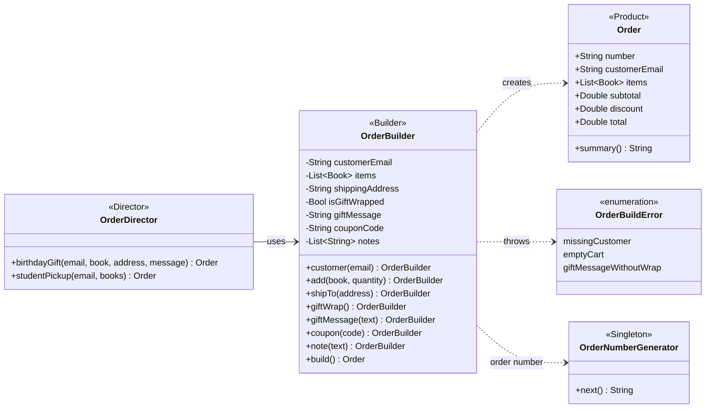

#### Diagram — Builder step by step

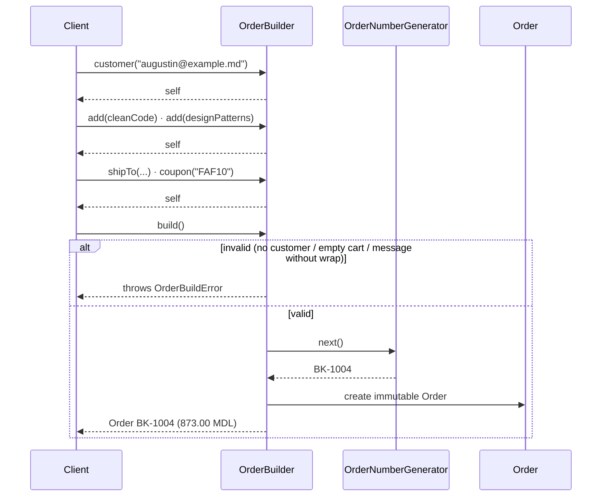


### 3.3 Factory Method — DeliveryService

📄 [`Sources/CreationalCore/FactoryMethod/Shipment.swift`](../Sources/CreationalCore/FactoryMethod/Shipment.swift) · [`Sources/CreationalCore/FactoryMethod/DeliveryService.swift`](../Sources/CreationalCore/FactoryMethod/DeliveryService.swift)

**Problem.** An order can be delivered by courier, by national post or picked up in the store. The dispatch logic (compute the cost, build the tracking code, produce a message) is the same for all of them. If it contained a `switch` over the delivery type, every new carrier would require editing and re-testing that code.

**Solution.** `Shipment` is the **product** interface. The concrete products are `CourierShipment`, `PostShipment` and `StorePickup`:

```swift
public protocol Shipment {
    var carrier: String { get }
    var estimate: String { get }
    var trackingPrefix: String { get }
    func cost(for order: Order) -> Double
}

/// Courier in Chișinău: 50 MDL, free for orders of 800 MDL or more.
public struct CourierShipment: Shipment {
    public let carrier = "Courier"
    public let estimate = "next day"
    public let trackingPrefix = "CR"
    public func cost(for order: Order) -> Double { order.subtotal >= 800 ? 0 : 50 }
}

// PostShipment  → "Poșta Moldovei", 35 MDL, "3-5 days"
// StorePickup   → "Store pickup",   0 MDL,  "ready in 2 hours"
```

`DeliveryService` is the **creator**. Its `dispatch(_:)` method contains the shared algorithm, but it calls the **factory method** `makeShipment()` to get the product. Each concrete creator implements `makeShipment()` and decides which shipment to create. In Swift the abstract creator is a protocol, and the shared logic lives in a protocol extension instead of an abstract base class.

```swift
public protocol DeliveryService {
    /// The factory method.
    func makeShipment() -> Shipment
}

public extension DeliveryService {
    /// Shared business logic. It works with whatever makeShipment() returns.
    func dispatch(_ order: Order) -> String {
        let shipment = makeShipment()
        let cost = shipment.cost(for: order)
        return "\(order.number) -> \(shipment.carrier): shipping \(money(cost)), "
             + "\(shipment.estimate), tracking \(shipment.trackingPrefix)-\(order.number)"
    }
}

public struct CourierDeliveryService: DeliveryService {
    public func makeShipment() -> Shipment { CourierShipment() }
}
public struct PostDeliveryService: DeliveryService {
    public func makeShipment() -> Shipment { PostShipment() }
}
public struct StorePickupService: DeliveryService {
    public func makeShipment() -> Shipment { StorePickup() }
}
```

#### Diagram — Factory Method class structure

The creator side (left) and the product side (right) mirror each other. Each concrete creator decides which concrete product to create.

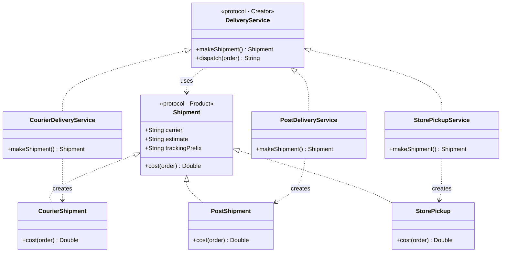

#### Diagram — Factory Method at runtime

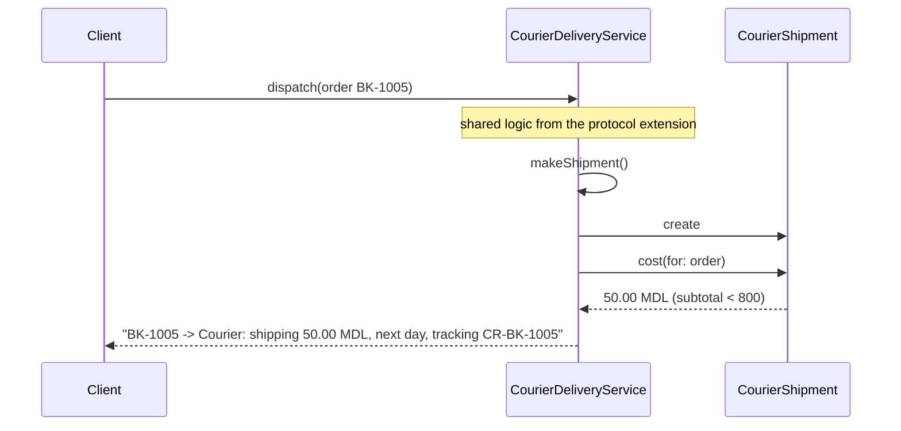


| GoF role | In this project |
|---|---|
| Product | `Shipment` |
| Concrete products | `CourierShipment`, `PostShipment`, `StorePickup` |
| Creator | `DeliveryService` (with `dispatch(_:)`) |
| Factory method | `makeShipment()` |
| Concrete creators | `CourierDeliveryService`, `PostDeliveryService`, `StorePickupService` |

A new carrier is added by writing one new `Shipment` and one new `DeliveryService`; `dispatch(_:)` is never modified. The unit tests prove this with a `DroneDeliveryService` defined only in the test file. This applies the Open/Closed Principle from the previous laboratory work.

## 4. Testing and results

The `CreationalTests` target checks each pattern with XCTest:

| Pattern | Test | What it proves |
|---|---|---|
| Singleton | `testAlwaysTheSameInstance` | `shared === shared` |
| Singleton | `testNumbersAreUniqueAcrossThreads` | 1000 concurrent calls (`DispatchQueue.concurrentPerform`) produce 1000 unique numbers |
| Builder | `testBuildsCompleteOrder` | 2 × 500 MDL, 10% coupon, 25 MDL gift wrap = **925 MDL** |
| Builder | `testRejectsMissingCustomer`, `testRejectsEmptyCart`, `testRejectsGiftMessageWithoutWrap` | Invalid orders are rejected with the right error |
| Builder | `testDirectorBirthdayGift` | The director creates a gift-wrapped order |
| Factory Method | `testEachServiceCreatesItsOwnShipment` | Each creator returns its own product type |
| Factory Method | `testCourierIsFreeFrom800` | 799 MDL → 50 MDL shipping, 800 MDL → free |
| Factory Method | `testNewServiceWorksWithoutChangingDispatch` | A new `DroneDeliveryService` works with `dispatch(_:)` unchanged |

Running `swift run CreationalDemo` produces the output below. The order numbers continue from the Singleton section into the Builder section (BK-1004 to BK-1006), which shows that both parts use the same instance. The Factory Method section shows the same order dispatched by three different creators, and then a service chosen automatically for each order.

```
========== SINGLETON - one shared order-number generator ==========
Same instance: true
Checkout gets:    BK-1001
Admin panel gets: BK-1002
Checkout gets:    BK-1003

========== BUILDER - step-by-step order construction ==========
Order BK-1004 for augustin@example.md
  Items: Clean Code, Design Patterns
  Delivery: str. Studenților 7, Chișinău
  Coupon: FAF10
  Subtotal 970.00 MDL, discount 97.00 MDL, gift wrap 0.00 MDL -> total 873.00 MDL

Director presets:
Order BK-1005 for ana@example.md
  Items: Swift Programming
  Delivery: bd. Ștefan cel Mare 168, Chișinău
  Gift wrap: yes ("La mulți ani!")
  Note: Deliver before the weekend
  Subtotal 320.00 MDL, discount 0.00 MDL, gift wrap 25.00 MDL -> total 345.00 MDL
Order BK-1006 for student@utm.md
  Items: Design Patterns, Swift Programming
  Delivery: pickup in store
  Coupon: FAF10
  Note: Pickup at FCIM, UTM
  Subtotal 840.00 MDL, discount 84.00 MDL, gift wrap 0.00 MDL -> total 756.00 MDL

Invalid builds are rejected:
  no customer: customer email is missing or invalid
  empty cart: the cart is empty
  message without wrap: a gift message requires gift wrapping

========== FACTORY METHOD - each service creates its own shipment ==========
BK-1004 -> Courier: shipping 0.00 MDL, next day, tracking CR-BK-1004
BK-1004 -> Poșta Moldovei: shipping 35.00 MDL, 3-5 days, tracking PM-BK-1004
BK-1004 -> Store pickup: shipping 0.00 MDL, ready in 2 hours, tracking PU-BK-1004

Service chosen per order:
BK-1004 -> Courier: shipping 0.00 MDL, next day, tracking CR-BK-1004
BK-1005 -> Courier: shipping 50.00 MDL, next day, tracking CR-BK-1005
BK-1006 -> Store pickup: shipping 0.00 MDL, ready in 2 hours, tracking PU-BK-1006
```

**How to run:**

```bash
cd lab1
swift run CreationalDemo
swift test
```

In Xcode: **File → Open… → `lab1/Package.swift`**, scheme **CreationalDemo** → ⌘R to run, ⌘U for tests.

## 5. The other creational patterns

### 5.1 Prototype

New objects are created by **copying** an existing, already configured object (the prototype) instead of building them from scratch. In Swift, structs are copied automatically on assignment; classes implement a `clone()` method. Useful when setup is expensive or when many objects differ only slightly.

```swift
final class BookTemplate {
    var format: String, language: String, price: Double
    init(format: String, language: String, price: Double) {
        self.format = format; self.language = language; self.price = price
    }
    func clone() -> BookTemplate {          // the prototype copies itself
        BookTemplate(format: format, language: language, price: price)
    }
}

let hardcoverRO = BookTemplate(format: "Hardcover", language: "RO", price: 300)
let copy = hardcoverRO.clone()   // same settings, independent object
copy.price = 280                 // the original still costs 300
```

#### Diagram — Prototype

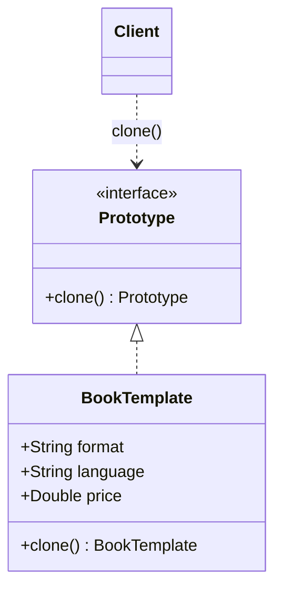


### 5.2 Object Pool

A fixed set of expensive objects is created once and **reused**. A client acquires an object from the pool, uses it and releases it back, instead of creating and destroying it each time. This is typical for database connections, threads and sockets.

```swift
final class ConnectionPool {
    private var available: [DBConnection]
    init(size: Int) { available = (1...size).map { DBConnection(id: $0) } }

    func acquire() -> DBConnection? { available.popLast() }   // nil = pool exhausted
    func release(_ c: DBConnection) { available.append(c) }
}
```

#### Diagram — Object Pool structure

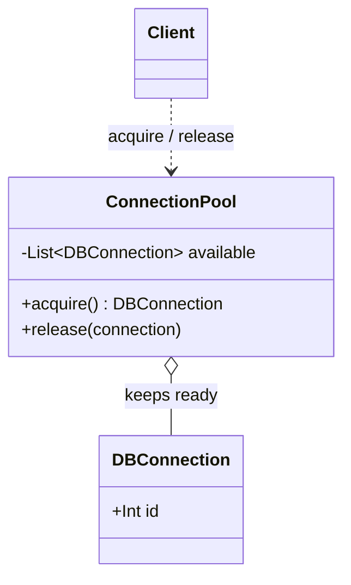

#### Diagram — Object Pool lifecycle

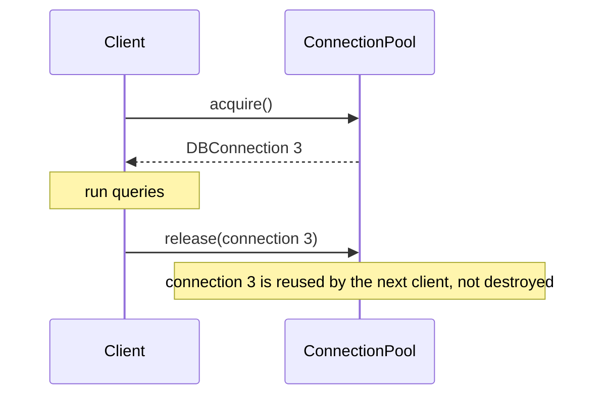


> **Note.** A database connection should not be a Singleton. One shared connection becomes a bottleneck, is not safe for concurrent writes and cannot be replaced in tests. Object Pool is the right pattern for connections.

### 5.3 Abstract Factory

An interface creates a **whole family of related objects**, so the objects always match each other. The client chooses one concrete factory and never names the concrete products.

```swift
protocol StoreThemeFactory {
    func makeButton() -> Button
    func makeBanner() -> Banner
}
struct LightThemeFactory: StoreThemeFactory {
    func makeButton() -> Button { LightButton() }
    func makeBanner() -> Banner { LightBanner() }
}
struct DarkThemeFactory: StoreThemeFactory {
    func makeButton() -> Button { DarkButton() }
    func makeBanner() -> Banner { DarkBanner() }
}
// The screen receives one factory and gets a matching button + banner.
```

#### Diagram — Abstract Factory

One factory produces a whole matching family: the Light factory never creates a Dark button.

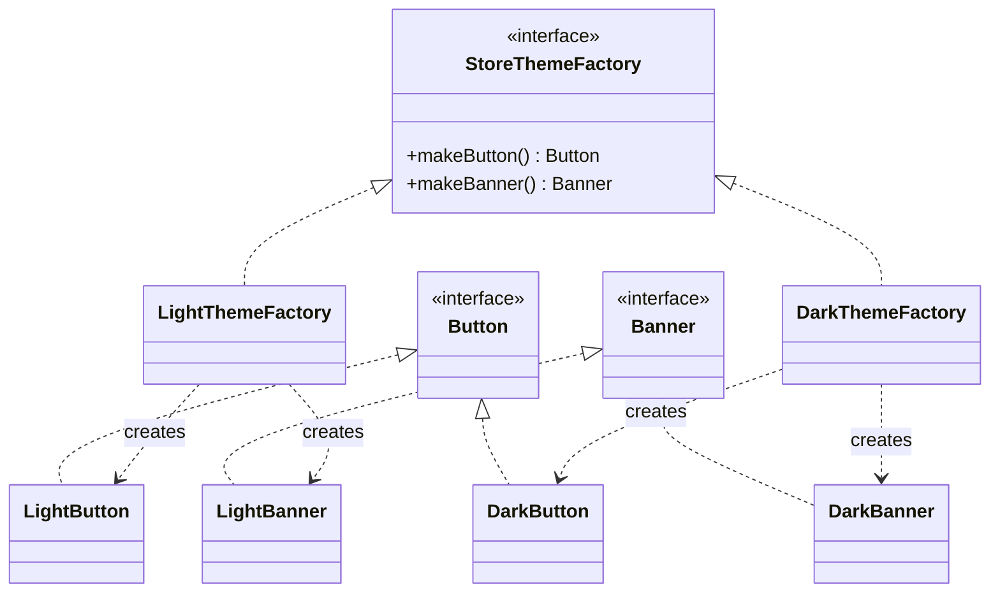


| | Factory Method | Abstract Factory |
|---|---|---|
| **Creates** | One product | A family of related products |
| **Mechanism** | A method overridden / implemented by subtypes | A separate factory object with several creation methods |
| **Example here** | `makeShipment()` | `makeButton()` + `makeBanner()` |

## Conclusion

In this laboratory work three creational design patterns were implemented in Swift and combined in one bookstore application.

The **Singleton** guarantees one order-number generator for the whole program, so numbers never repeat, even under concurrent access. Swift makes the pattern short (`static let` plus a `private init`), but it is still global state and should be used only where exactly one instance is truly required.

The **Builder** replaced a long, error-prone initializer with readable step-by-step construction. It keeps the final `Order` immutable and puts validation in a single place, `build()`; the **Director** reuses common construction sequences.

The **Factory Method** separated the dispatch algorithm from the decision of which shipment to create. New carriers are added without modifying existing code, which applies the Open/Closed Principle from the previous laboratory work.

Prototype, Object Pool and Abstract Factory were also studied. Together, the six patterns show the main ways to control object creation: limiting the number of instances, assembling complex objects, copying, reusing, and delegating the choice of concrete classes.

## Bibliography

1. Gamma, E., Helm, R., Johnson, R., Vlissides, J. *Design Patterns: Elements of Reusable Object-Oriented Software*. Addison-Wesley, 1994.
2. Shvets, A. *Dive Into Design Patterns*. refactoring.guru, 2021.
3. Apple Inc. *The Swift Programming Language — Properties, Protocols, Error Handling*. docs.swift.org.

**Repository:** https://github.com/Afyze/tmps-2026-AugustinCarazanu/tree/main/lab1
