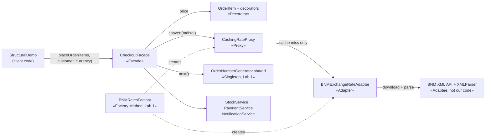
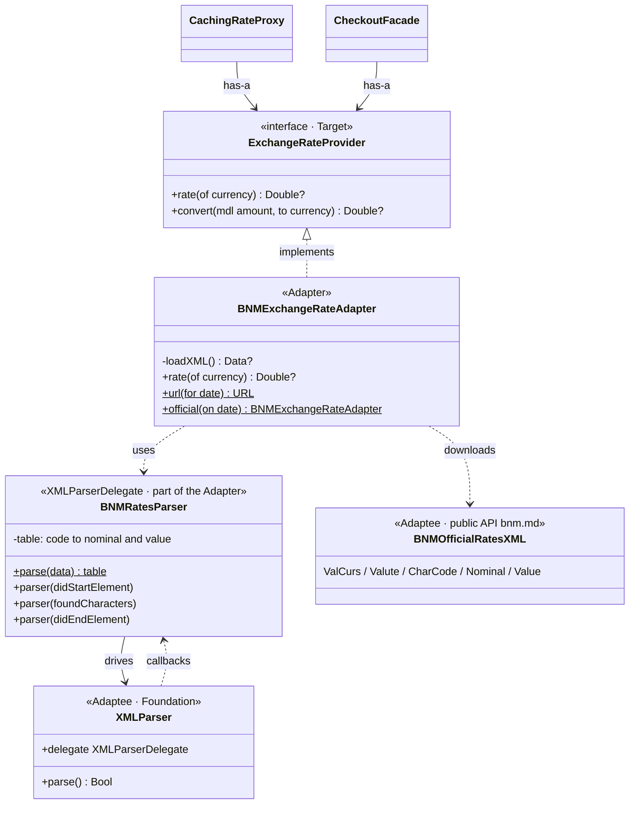
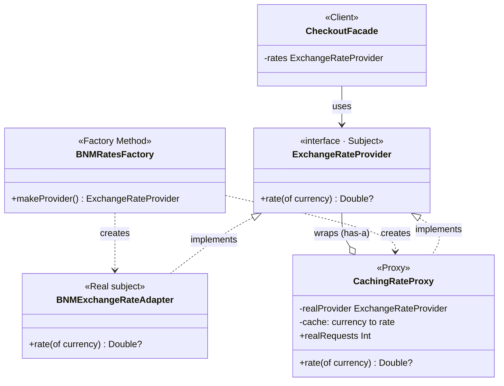
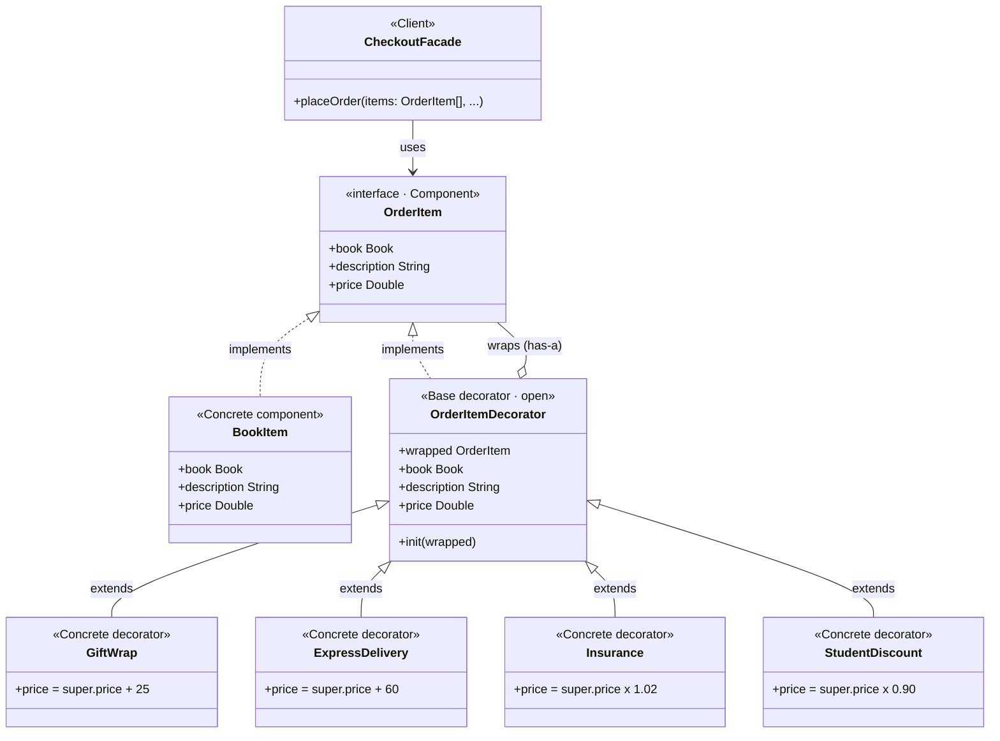
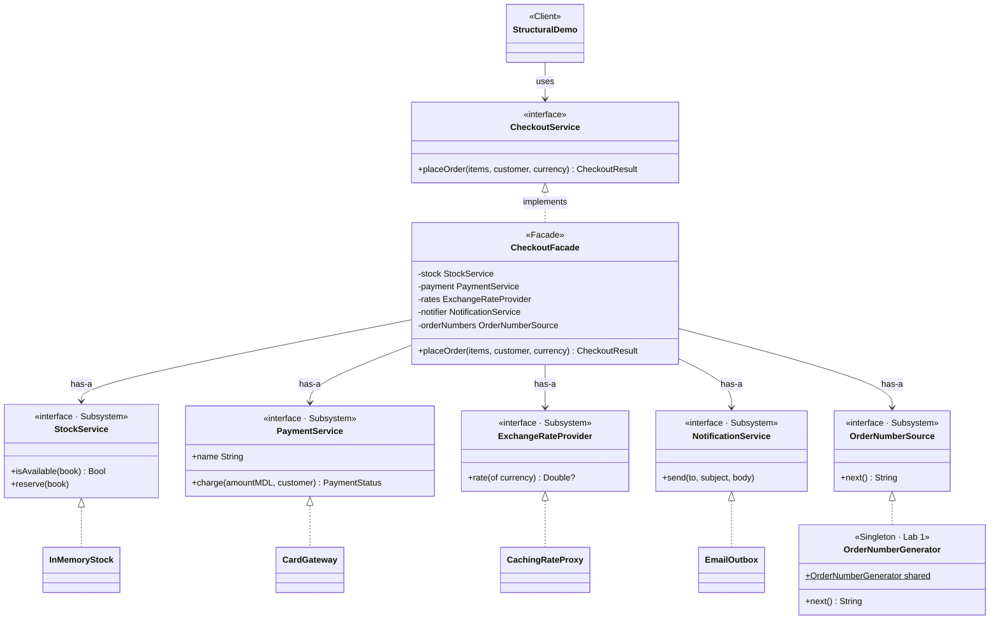

# Laboratory Work No. 2 — Structural Design Patterns

| | |
|---|---|
| **Discipline** | Techniques and Mechanisms of Software Design (TMPS) |
| **Student** | Augustin Carazanu, FAF-243 |
| **Checked by** | assist. univ. Daniel Istrati |
| **Language** | Swift 5.9 (Swift Package Manager, XCTest) |
| **Patterns implemented** | Adapter, Proxy, Decorator, Facade (+ Factory Method and Singleton from Lab 1) |

---

## 1. Domain description

The project is the **online bookstore** from the previous laboratory works (Lab 0 and Lab 1), extended with a **checkout that works in several currencies**.

A customer puts books in the cart. Each book can get **extras**: gift wrap, express delivery, insurance or a student discount. At checkout the shop:

1. checks that every book is in stock,
2. computes the total in MDL and shows it in the customer's currency (EUR, USD, RON, …) using the **official exchange rates published by the National Bank of Moldova (BNM)**,
3. charges the card,
4. reserves the books, gives the order a unique number and emails a receipt.

The rates come from BNM's **public XML API** (`https://www.bnm.md/en/official_exchange_rates?get_xml=1&date=dd.MM.yyyy`), which we did not design and cannot change.

### How the patterns work together

One execution path passes through all of them: **client → Facade → Proxy → Adapter → BNM API**, with objects created by a **Factory Method** and order numbers from the **Singleton** of Lab 1.



### Building on Lab 1

- `lab2/Package.swift` depends on the `lab1` package. `Book` and `money()` are reused from Lab 1's `CreationalCore`.
- **Singleton (Lab 1):** `OrderNumberGenerator.shared` gives every order a unique number. It conforms to the new `OrderNumberSource` protocol through a one-line extension, without changing Lab 1's code ([`OrderNumberGenerator+OrderNumberSource.swift`](../Sources/StructuralCore/Creational/OrderNumberGenerator+OrderNumberSource.swift)).
- **Factory Method:** `ExchangeRateProviderFactory` / `BNMRatesFactory.makeProvider()` creates the Proxy → Adapter chain. The client receives only an `ExchangeRateProvider` ([`ExchangeRateProviderFactory.swift`](../Sources/StructuralCore/Creational/ExchangeRateProviderFactory.swift)).

### Project structure

```
lab2/
├── Package.swift                     depends on ../lab1 (CreationalCore)
├── Sources/
│   ├── StructuralCore/
│   │   ├── Domain/                   Checkout.swift (Receipt, CheckoutResult, PaymentStatus, Email)
│   │   ├── Patterns/
│   │   │   ├── Adapter/              ExchangeRateProvider.swift, BNMExchangeRateAdapter.swift
│   │   │   ├── Proxy/                CachingRateProxy.swift
│   │   │   ├── Decorator/            OrderItem.swift, OrderItemDecorator.swift, ConcreteDecorators.swift
│   │   │   └── Facade/               SubsystemInterfaces.swift, CheckoutFacade.swift
│   │   ├── Creational/               ExchangeRateProviderFactory.swift, OrderNumberGenerator+OrderNumberSource.swift
│   │   └── Services/                 InMemoryStock.swift, CardGateway.swift, EmailOutbox.swift
│   └── StructuralDemo/               main.swift (client), SampleRates.swift
└── Tests/StructuralTests/            Adapter-, Proxy-, Decorator-, Facade-, IntegrationTests.swift, Fixtures.swift
```

---

## 2. Patterns

### 2.1 Adapter — the BNM exchange-rate API

**Problem in this project.** The checkout needs one simple thing: *"how many MDL does 1 EUR cost?"*. BNM does not offer that. It publishes an XML document with all currencies, where each rate is given **per `Nominal` units**. The only XML parser in Foundation, `XMLParser`, does not return values: it is **event-driven** and calls delegate methods for every tag and every piece of text. Both are code we did not write and cannot change. Without an adapter, the download, the XML callbacks and the `Value / Nominal` arithmetic would leak into the checkout.

**Roles.** Target: `ExchangeRateProvider` · Adapter: `BNMExchangeRateAdapter` (+ its helper `BNMRatesParser`, the `XMLParserDelegate`) · Adaptees: the BNM XML API and Foundation's `XMLParser` · Clients: `CachingRateProxy`, `CheckoutFacade`.

#### Class diagram



#### Code

📄 [`Sources/StructuralCore/Patterns/Adapter/BNMExchangeRateAdapter.swift`](../Sources/StructuralCore/Patterns/Adapter/BNMExchangeRateAdapter.swift)

```swift
public func rate(of currency: String) -> Double? {
    let code = currency.uppercased()
    if code == "MDL" { return 1 }                          // the base currency
    guard let xml = loadXML() else { return nil }          // 1. adaptee: XML document
    let table = BNMRatesParser.parse(xml)                  // 2. XMLParser events -> table
    guard let entry = table[code], entry.nominal > 0 else { return nil }
    return entry.value / entry.nominal                     // 3. "Value per Nominal" -> per 1 unit
}

// BNMRatesParser (XMLParserDelegate): collects one entry per <Valute>
func parser(_ parser: XMLParser, didEndElement elementName: String, namespaceURI: String?,
            qualifiedName qName: String?) {
    let content = text.trimmingCharacters(in: .whitespacesAndNewlines)
    switch elementName {
    case "CharCode": code = content.uppercased()
    case "Nominal":  nominal = Double(content) ?? 1
    case "Value":    value = Double(content.replacingOccurrences(of: ",", with: ".")) ?? 0
    case "Valute":   if !code.isEmpty { table[code] = (nominal: nominal, value: value) }
    default:         break
    }
    text = ""
}
```

The client calls one method, `rate(of:)`. The adapter turns that call into the adaptees' language: it loads the XML, drives `XMLParser` with a delegate that collects the `CharCode`, `Nominal` and `Value` callbacks, and converts BNM's "value per nominal" into "MDL per 1 unit".

#### Unit tests

| Test | What it checks |
|---|---|
| `AdapterTests.testTranslatesBNMXMLIntoRates` | The real BNM XML format (rates of 05.11.2026) becomes `EUR → 20.1773`, `USD → 17.9274`, `RON → 3.7751`. The currency code is case-insensitive. |
| `AdapterTests.testDividesValueByNominal` | A currency quoted per 10 units (`Nominal 10`, `Value 2.5`) gives 0.25 MDL per unit. |
| `AdapterTests.testBaseAndUnknownCurrencies` | `MDL → 1`; a currency missing from the XML and a failed download both give `nil`. |
| `AdapterTests.testConvertsThroughTargetInterface` | A client holding only `ExchangeRateProvider` converts 1000 MDL → 49.56 EUR. |
| `AdapterTests.testBuildsOfficialURL` | The request goes to `…official_exchange_rates?get_xml=1&date=05.11.2026`. |

Test log: see [section 3](#3-test-run).

---

### 2.2 Proxy — caching the exchange rates

**Problem in this project.** Every call to the adapter downloads and parses the whole BNM document again. Official rates change **once a day**, but the checkout asks for a rate on **every order**. The proxy stands in front of the adapter with **the same interface**. It forwards only the first request for each currency and answers the rest from memory. The facade does not know it is talking to a proxy.

**Roles.** Subject: `ExchangeRateProvider` · Real subject: `BNMExchangeRateAdapter` · Proxy: `CachingRateProxy` · Client: `CheckoutFacade`.

#### Class diagram



#### Code

📄 [`Sources/StructuralCore/Patterns/Proxy/CachingRateProxy.swift`](../Sources/StructuralCore/Patterns/Proxy/CachingRateProxy.swift)

```swift
public final class CachingRateProxy: ExchangeRateProvider {
    private let realProvider: ExchangeRateProvider
    private var cache: [String: Double] = [:]
    public private(set) var realRequests = 0

    public init(wrapping realProvider: ExchangeRateProvider) {
        self.realProvider = realProvider
    }

    public func rate(of currency: String) -> Double? {
        let code = currency.uppercased()
        if let cached = cache[code] {                        // hit: no download
            return cached
        }
        realRequests += 1                                   // miss: delegate
        guard let fresh = realProvider.rate(of: code) else {
            return nil                                      // unknown: not cached
        }
        cache[code] = fresh
        return fresh
    }
}
```

The proxy implements the same `ExchangeRateProvider` interface as the real subject and holds a reference to it. It controls access to the expensive call: it delegates only on a cache miss and returns the real answer unchanged.

**Measurement (demo, `--offline`):** for the lookups `EUR, EUR, USD, EUR`, the adapter alone reads the XML **4** times, and through the proxy only **2** times, with identical answers. During checkout, 5 orders need only 3 XML loads.

#### Unit tests

| Test | What it checks |
|---|---|
| `ProxyTests.testPassesAnswersThroughUnchanged` | For EUR, USD, RON, GBP and MDL the proxy returns exactly what the adapter returns. |
| `ProxyTests.testCallsRealProviderOncePerCurrency` | 4 lookups (`EUR, EUR, eur, USD`) reach the real provider only **2** times. |
| `ProxyTests.testDoesNotCacheMissingRates` | An unknown currency is not cached, so it is asked again (it may be published later). |
| `IntegrationTests.testFactoryReturnsProxyAroundAdapter` | The factory hands the client a `CachingRateProxy` behind `ExchangeRateProvider`. |

Test log: see [section 3](#3-test-run).

---

### 2.3 Decorator — extras on an order line

**Problem in this project.** Any book can get any combination of extras: gift wrap (+25 MDL), express delivery (+60 MDL), insurance (+2%) and student discount (−10%). A subclass per combination (`GiftWrappedExpressBook`, `DiscountedInsuredBook`, …) would already mean 15 classes for 4 extras. A single class with 4 flags would have to be edited for every new extra. With decorators, extras are **wrapped around the book at runtime**, in any number and order.

**Roles.** Component: `OrderItem` · Concrete component: `BookItem` · Base decorator: `OrderItemDecorator` · Concrete decorators: `GiftWrap`, `ExpressDelivery`, `Insurance`, `StudentDiscount` · Client: `CheckoutFacade` (reads `price` and `description` through `OrderItem`).

#### Class diagram



#### Code

📄 [`Sources/StructuralCore/Patterns/Decorator/OrderItemDecorator.swift`](../Sources/StructuralCore/Patterns/Decorator/OrderItemDecorator.swift) · [`ConcreteDecorators.swift`](../Sources/StructuralCore/Patterns/Decorator/ConcreteDecorators.swift)

```swift
open class OrderItemDecorator: OrderItem {
    public let wrapped: OrderItem

    public init(_ wrapped: OrderItem) {
        self.wrapped = wrapped
    }

    open var book: Book { wrapped.book }
    open var description: String { wrapped.description }
    open var price: Double { wrapped.price }
}

public final class GiftWrap: OrderItemDecorator {
    public override var description: String { super.description + " + gift wrap" }
    public override var price: Double { super.price + 25 }
}

public final class StudentDiscount: OrderItemDecorator {
    public override var description: String { super.description + " - student discount 10%" }
    public override var price: Double { super.price * 0.90 }
}

// usage: BookItem(swiftBook).studentDiscount().giftWrapped().express()   // 320 -> 288 -> 313 -> 373 MDL
```

The base decorator **is** an `OrderItem` and **has** an `OrderItem`, and by default it forwards everything unchanged. Each concrete decorator overrides only its own part and calls `super`, which asks the wrapped item. That is why decorators stack in any number. Because the class is `open`, a new extra is just a new subclass. The tests add `Engraving` without editing any existing file.

#### Unit tests

| Test | What it checks |
|---|---|
| `DecoratorTests.testStackedInAnyOrderGiveSameResult` | All **6 orders** of `GiftWrap`, `ExpressDelivery` and the test-only `Engraving` give 100 + 25 + 60 + 40 = 225 MDL. This also proves a new decorator can be added without editing existing classes. |
| `DecoratorTests.testBaseDecoratorForwardsUnchanged` | `OrderItemDecorator` alone returns the same price, description and book as the item it wraps. |
| `DecoratorTests.testEachDecoratorAddsItsPart` | A 4-layer stack gives (100 × 0.9 + 25 + 60) × 1.02 = 178.50 MDL with the right description, and the original book is kept. |
| `DecoratorTests.testDiscountDependsOnWhatItWraps` | (100 + 25) × 0.9 = 112.50 vs 100 × 0.9 + 25 = 115. A percentage decorator applies to everything it wraps. |

Test log: see [section 3](#3-test-run).

---

### 2.4 Facade — CheckoutFacade

**Problem in this project.** Placing an order touches five subsystems in a fixed order: stock → rates → payment → reserve stock → order number → email. Every failure must stop at the right step. An out-of-stock book or an unknown currency must **never be charged**, and a declined payment must **reserve nothing**. If every client did this itself, the sequence would be duplicated and easy to get wrong. The facade gives the client **one call**, `placeOrder(items:customer:currency:)`. It only coordinates: prices come from the decorated items, rates from the provider and limits from the payment service, so it does not become a god class.

**Roles.** Facade: `CheckoutFacade` (behind the `CheckoutService` interface) · Subsystems, all used through interfaces: `StockService`, `ExchangeRateProvider`, `PaymentService`, `OrderNumberSource`, `NotificationService` · Default implementations: `InMemoryStock`, `CachingRateProxy`, `CardGateway`, `OrderNumberGenerator` (Lab 1), `EmailOutbox` · Client: `StructuralDemo`.

#### Class diagram



#### Code

📄 [`Sources/StructuralCore/Patterns/Facade/CheckoutFacade.swift`](../Sources/StructuralCore/Patterns/Facade/CheckoutFacade.swift)

```swift
public func placeOrder(items: [OrderItem], customer: String, currency: String) -> CheckoutResult {
    guard !items.isEmpty else {
        return .failure(reason: "the cart is empty")
    }
    if let missing = items.first(where: { !stock.isAvailable($0.book) }) {          // 1. stock
        return .failure(reason: "'\(missing.book.title)' is out of stock")
    }
    let totalMDL = items.reduce(0) { $0 + $1.price }                                 // 2. decorated prices
    guard let totalInCurrency = rates.convert(mdl: totalMDL, to: currency) else {     // 3. rates (Proxy -> Adapter)
        return .failure(reason: "no exchange rate for \(currency.uppercased())")
    }
    switch payment.charge(totalMDL, customer: customer) {                            // 4. payment
    case .declined(let reason):
        return .failure(reason: "payment declined by \(payment.name): \(reason)")
    case .approved(let transactionID):
        items.forEach { stock.reserve($0.book) }                                     // 5. reserve
        let receipt = Receipt(orderNumber: orderNumbers.next(),                     // 6. number (Singleton)
                              customer: customer,
                              lines: items.map { "\($0.description): \(money($0.price))" },
                              totalMDL: totalMDL, currency: currency.uppercased(),
                              totalInCurrency: totalInCurrency,
                              paidWith: payment.name, transactionID: transactionID)
        notifier.send(to: customer,                                                  // 7. email
                      subject: "Order \(receipt.orderNumber) confirmed", body: receipt.text)
        return .success(receipt)
    }
}
```

Each step is one call to a subsystem interface, in a fixed order. Each `return .failure` stops the sequence before anything is charged, reserved or sent. The facade adds the order of the steps and nothing else, so any subsystem can be replaced by a mock or a new implementation without editing it.

#### Unit tests (with mocks)

| Test | What it checks |
|---|---|
| `FacadeTests.testCallsSubsystemsInTheRightOrder` | With mock subsystems that log their calls, a successful order produces exactly `stock.isAvailable → rates.rate(EUR) → payment.charge(125.00) → stock.reserve → numbers.next() → notifier.send`. The receipt total is 125 MDL / 20 = 6.25 EUR. |
| `FacadeTests.testOutOfStockStopsBeforePayment` | Out of stock: the only call is `stock.isAvailable`. Rates and payment are never touched. |
| `FacadeTests.testUnknownCurrencyIsNeverCharged` | No rate for GBP: no `payment` call at all. |
| `FacadeTests.testDeclinedPaymentReservesNothing` | Declined: the log stops at `payment.charge`. Nothing is reserved, no number is used and no email is sent. |
| `IntegrationTests.testClientToFacadeToProxyToAdapter` | The real chain **client → Facade → Proxy → Adapter**: two EUR orders give decorated price ÷ BNM rate, only **1** XML load (second from cache), numbers from the Lab 1 Singleton (`BK-…`, different) and 2 emails. |

Test log: see [section 3](#3-test-run).

---

## 3. Test run

All tests run with one command from the `lab2` folder:

```bash
swift test
```

<!-- TEST-LOG -->

## 4. Demo

`swift run StructuralDemo` downloads today's official rates from bnm.md. `swift run StructuralDemo --offline` uses a saved copy of the official rates of **05.11.2026**, so the output is always the same:

```
========== ADAPTER - official BNM XML API behind ExchangeRateProvider ==========
Source: offline: saved copy of the official BNM rates of 05.11.2026
  1 EUR = 20.1773 MDL
  1 USD = 17.9274 MDL
  1 RON = 3.7751 MDL
  1 GBP = not published in this XML
  1000.00 MDL = 49.56 EUR

========== PROXY - CachingRateProxy in front of the adapter ==========
Lookups: EUR, EUR, USD, EUR
  without proxy: 4 lookups -> 4 XML loads
  with proxy:    4 lookups -> 2 XML loads (2 reached the adapter)
  same answers through the proxy: true

========== DECORATOR - extras wrapped around a book at runtime ==========
  Clean Code: 450.00 MDL
  Design Patterns + gift wrap: 545.00 MDL
  Design Patterns + insurance 2%: 530.40 MDL
  Swift Programming - student discount 10% + gift wrap + express delivery: 373.00 MDL
Additive extras give the same price in any order:
  Clean Code + gift wrap + express delivery: 535.00 MDL
  Clean Code + express delivery + gift wrap: 535.00 MDL
A discount depends on what it wraps:
  Design Patterns + gift wrap - student discount 10%: 490.50 MDL
  Design Patterns - student discount 10% + gift wrap: 493.00 MDL

========== FACADE - one call places the whole order ==========
Order 1 (augustin@example.md, EUR): SUCCESS BK-1001, 995.00 MDL = 49.31 EUR, transaction BC-7001
Order 2 (ana@example.md, MDL): FAILED: 'Design Patterns' is out of stock
Order 3 (student@utm.md, RON): SUCCESS BK-1002, 465.00 MDL = 123.18 RON, transaction BC-7002
Order 4 (collector@example.md, EUR): FAILED: payment declined by Bank card: insufficient funds (limit 5000.00 MDL)
Order 5 (guest@example.co.uk, GBP): FAILED: no exchange rate for GBP
BNM XML loads during checkout: 3 (EUR, RON, GBP; the second EUR came from the proxy cache)

Emails sent:
  To augustin@example.md: Order BK-1001 confirmed
  To student@utm.md: Order BK-1002 confirmed

First receipt:
RECEIPT BK-1001 - augustin@example.md
  Clean Code: 450.00 MDL
  Design Patterns + gift wrap: 545.00 MDL
  TOTAL: 995.00 MDL = 49.31 EUR (official BNM rate)
  Paid via Bank card, transaction BC-7001

Stock left: Clean Code 1, Design Patterns 0, Swift Programming 0, Collector's Edition 1
```

---

## 5. Open for extension

Every variant below is added with **new classes only**:

| New requirement | What to add | Existing code edited |
|---|---|---|
| A new extra (e.g. engraving +40 MDL) | `final class Engraving: OrderItemDecorator` | none (done in `DecoratorTests`) |
| Another rate source (e.g. the European Central Bank) | an adapter `ECBExchangeRateAdapter: ExchangeRateProvider` + a factory | none |
| Rates that expire after a day | `ExpiringRateProxy: ExchangeRateProvider` | none |
| Another payment method or SMS notification | a class implementing `PaymentService` / `NotificationService` | none |

---

## 6. Conclusions

**What was harder than expected.**

- **Finding a real adaptee.** Adapting a class I wrote myself would not show a real incompatibility. The BNM API is a good fit because two things do not match the shop at once: the data (a whole XML document, rates per `Nominal`) and the API style (`XMLParser` is event-driven, not a function that returns a value). Keeping all of that inside the adapter, so the checkout never sees XML, was the main design work.
- **Keeping the Facade thin.** The first temptation was to compute totals, apply limits and format receipts inside `placeOrder`. Moving every rule to its subsystem (decorated items for prices, the provider for rates, the gateway for limits) and putting every subsystem behind a protocol made the facade short. It also made the "right order" test with mocks possible.
- **Decorator order.** Additive extras commute, but percentage ones do not: a discount applied after gift wrap also discounts the wrap. This is correct Decorator behaviour, but it is a business decision, so the tests document both orders.

**What I would design differently.**

- The adapter downloads and parses the whole document for every currency. Parsing it once into a table per day (and letting the proxy cache that table) would be more efficient. The current version keeps each class's job very clear and makes the proxy's effect easy to measure.
- The proxy caches forever. A real shop should expire the cache at midnight, when BNM publishes new rates. That would be a new proxy class or a clock injected into this one.
- Using `OrderNumberGenerator.shared` (Singleton from Lab 1) as a default argument is convenient, but it is still global state. Tests inject `OrderNumberSource` mocks for this reason.
- Money is stored as `Double`. A production version should use `Decimal` to avoid rounding errors in prices.
