# Laboratory Work No. 2 — Structural Design Patterns

**Technical University of Moldova**
Faculty of Computers, Informatics and Microelectronics
Department of Software Engineering and Automation

| | |
|---|---|
| **Discipline** | Techniques and Mechanisms of Software Design (TMPS) |
| **Topic** | Structural Design Patterns (Adapter, Decorator, Facade) |
| **Done by** | st. gr. FAF-243, Augustin Carazanu |
| **Checked by** | assist. univ. Daniel Istrati |
| **Year** | Chișinău, 2026 |

---

## Table of contents

1. [Objectives](#1-objectives)
2. [Theoretical background](#2-theoretical-background)
3. [Implementation](#3-implementation)
   - [3.1 Adapter — payment providers](#31-adapter--payment-providers)
   - [3.2 Decorator — order extras](#32-decorator--order-extras)
   - [3.3 Facade — CheckoutFacade](#33-facade--checkoutfacade)
4. [Testing and results](#4-testing-and-results)
5. [The other structural patterns](#5-the-other-structural-patterns)
6. [Conclusion](#conclusion)
7. [Bibliography](#bibliography)

---

## 1. Objectives

- Study the structural design patterns: Adapter, Bridge, Composite, Decorator, Facade, Flyweight and Proxy.
- Implement three of them in one Swift project: **Adapter**, **Decorator** and **Facade**.
- Show, through a demo program, UML diagrams and unit tests, what problem each pattern solves, and know the purpose and structure of the other four.

## 2. Theoretical background

**Structural patterns** describe how classes and objects are combined into larger structures while keeping those structures flexible. Creational patterns (previous laboratory work) answer *"how is an object created?"*; structural patterns answer *"how do objects fit together?"*. Most of them rely on **composition**: an object holds a reference to another object, often behind a common interface, and adds, translates or hides behaviour.

| Pattern | Intent | Typical use |
|---|---|---|
| **Adapter** | Convert the interface of a class into the interface clients expect. | Third-party libraries, legacy code, external APIs. |
| **Bridge** | Separate an abstraction from its implementation so the two can vary independently. | Shapes × renderers, reports × output formats, remotes × devices. |
| **Composite** | Compose objects into tree structures and treat single objects and groups uniformly. | Folders and files, menus, product bundles, UI view hierarchies. |
| **Decorator** | Attach additional responsibilities to an object dynamically by wrapping it. | Optional extras, streams, middleware, logging/caching wrappers. |
| **Facade** | Provide one simple interface to a complex subsystem. | Checkout, booking, video conversion, library entry points. |
| **Flyweight** | Share common state between many fine-grained objects to save memory. | Characters in a text editor, map tiles, particles, cover styles. |
| **Proxy** | Provide a placeholder that controls access to another object. | Lazy loading, access control, caching, remote objects, logging. |

This laboratory work implements **Adapter**, **Decorator** and **Facade**. **Bridge**, **Composite**, **Flyweight** and **Proxy** are explained with Swift examples and diagrams in [section 5](#5-the-other-structural-patterns).

## 3. Implementation

The project continues the online bookstore from the previous laboratory works. It is a Swift Package with three targets:

| Target | Role |
|---|---|
| `StructuralCore` | Library containing the patterns |
| `StructuralDemo` | Executable that shows the patterns working together |
| `StructuralTests` | XCTest unit tests |

```
lab2/
├── Package.swift
├── Sources/
│   ├── StructuralCore/
│   │   ├── Models.swift
│   │   ├── Adapter/    PaymentProcessor.swift  ThirdPartyPaymentAPIs.swift  PaymentAdapters.swift
│   │   ├── Decorator/  OrderItem.swift  ItemDecorators.swift
│   │   └── Facade/     Subsystems.swift  CheckoutFacade.swift
│   └── StructuralDemo/main.swift
└── Tests/StructuralTests/StructuralTests.swift
```

The three patterns cooperate in one use case, **placing an order**. `CheckoutFacade` is the single entry point. It prices the cart, where every line is an `OrderItem` that may be wrapped in **decorators**, and it pays through a `PaymentProcessor`, which is an **adapter** over a third-party payment API.

**Diagram — How the three patterns cooperate**

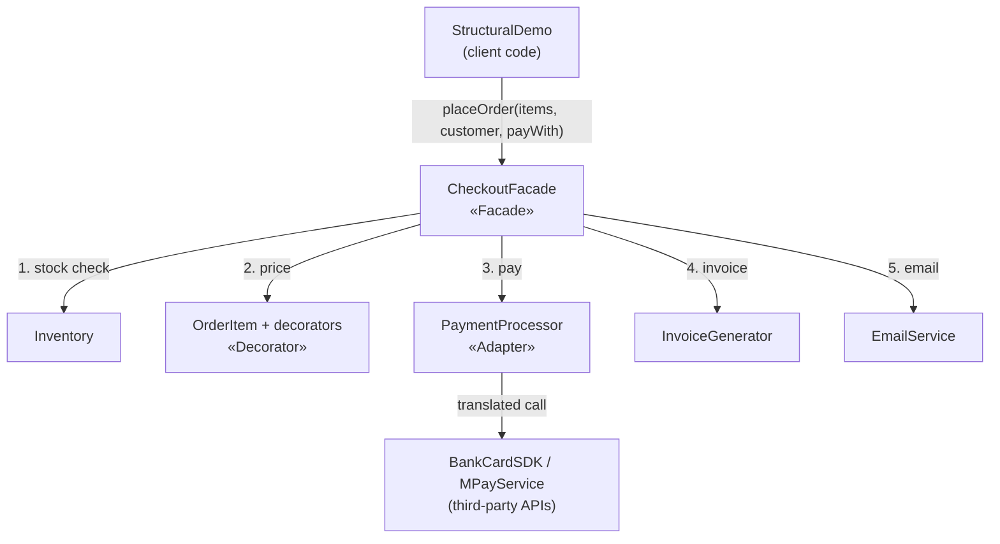

```swift
import Foundation

/// A book sold by the online bookstore (the same domain as Lab 0 and Lab 1).
public struct Book: Equatable {
    public let title: String
    public let author: String
    public let price: Double

    public init(title: String, author: String, price: Double) {
        self.title = title
        self.author = author
        self.price = price
    }
}

/// Formats an amount as "123.45 MDL".
public func money(_ amount: Double) -> String {
    String(format: "%.2f MDL", amount)
}
```

### 3.1 Adapter — payment providers

📄 [`Sources/StructuralCore/Adapter/PaymentProcessor.swift`](../Sources/StructuralCore/Adapter/PaymentProcessor.swift) · 📄 [`Sources/StructuralCore/Adapter/ThirdPartyPaymentAPIs.swift`](../Sources/StructuralCore/Adapter/ThirdPartyPaymentAPIs.swift) · 📄 [`Sources/StructuralCore/Adapter/PaymentAdapters.swift`](../Sources/StructuralCore/Adapter/PaymentAdapters.swift)

**Problem.** The shop works with one simple payment interface: an amount in MDL and a clear approved/declined result. The two payment providers it must support come as third-party libraries that cannot be modified, and neither matches that interface:

- `BankCardSDK` expects the amount in **bani** (`Int`, 1 MDL = 100 bani) and answers with **numeric codes** (0 = OK, 51 = insufficient funds).
- `MPayService` expects the amount as **text** and answers with a **text response** such as `STATUS=OK;TXN=MP-5001`.

Calling them directly would spread conversions and code parsing across the whole shop.

**Solution.** `PaymentProcessor` is the **target** interface. `BankCardSDK` and `MPayService` are the **adaptees**. `BankCardAdapter` and `MPayAdapter` implement `PaymentProcessor`, hold a reference to their adaptee (object adapter, by composition) and translate both ways: MDL to bani or text on the way in, codes or text responses to `PaymentStatus` on the way out. The rest of the shop, including the Facade, sees only `PaymentProcessor`.

```swift
// ADAPTER — the target interface
//
// This is the only payment interface the bookstore knows: an amount in MDL
// (Double), a customer, and a clear result. Every payment provider must be
// usable through it, no matter what its own API looks like.

public enum PaymentStatus: Equatable {
    case approved(transactionID: String)
    case declined(reason: String)
}

public protocol PaymentProcessor {
    var name: String { get }
    func pay(amount: Double, customer: String) -> PaymentStatus
}
```

```swift
import Foundation

// ADAPTER — the adaptees
//
// Two third-party payment libraries. We cannot change their code, and their
// interfaces do not match PaymentProcessor:
//   - BankCardSDK works in bani (1 MDL = 100 bani, Int) and answers with
//     numeric codes (0 = OK, 51 = insufficient funds).
//   - MPayService takes the amount as text and answers with a text
//     response such as "STATUS=OK;TXN=MP-5001".

/// Card-processing SDK provided by a bank.
public final class BankCardSDK {
    public private(set) var lastAmountInBani: Int?
    private var lastReference = 7000
    private let limitInBani = 500_000          // 5000 MDL per transaction

    public init() {}

    public func authorize(amountInBani: Int, cardholderEmail: String) -> (code: Int, reference: String) {
        lastAmountInBani = amountInBani
        guard amountInBani <= limitInBani else {
            return (code: 51, reference: "")
        }
        lastReference += 1
        return (code: 0, reference: "BC-\(lastReference)")
    }
}

/// Government payment service with a text-based API.
public final class MPayService {
    private var lastTransaction = 5000
    private let limit = 10_000.0               // MDL per payment

    public init() {}

    public func submitPayment(sum: String, payerID: String) -> String {
        guard let value = Double(sum), value > 0 else {
            return "STATUS=ERROR;MSG=invalid sum"
        }
        guard value <= limit else {
            return "STATUS=ERROR;MSG=limit exceeded"
        }
        lastTransaction += 1
        return "STATUS=OK;TXN=MP-\(lastTransaction)"
    }
}
```

```swift
import Foundation

// ADAPTER — the adapters
//
// Each adapter implements the target interface (PaymentProcessor) and
// translates the call into the adaptee's own language:
//   MDL Double -> bani Int / text amount, and
//   numeric code / text response -> PaymentStatus.
// The rest of the shop never sees BankCardSDK or MPayService directly.

public struct BankCardAdapter: PaymentProcessor {
    public let name = "Bank card"
    private let sdk: BankCardSDK

    public init(sdk: BankCardSDK = BankCardSDK()) {
        self.sdk = sdk
    }

    public func pay(amount: Double, customer: String) -> PaymentStatus {
        let bani = Int((amount * 100).rounded())                 // MDL -> bani
        let result = sdk.authorize(amountInBani: bani, cardholderEmail: customer)
        switch result.code {                                      // code -> status
        case 0:  return .approved(transactionID: result.reference)
        case 51: return .declined(reason: "insufficient funds (code 51)")
        default: return .declined(reason: "bank error (code \(result.code))")
        }
    }
}

public struct MPayAdapter: PaymentProcessor {
    public let name = "MPay"
    private let service: MPayService

    public init(service: MPayService = MPayService()) {
        self.service = service
    }

    public func pay(amount: Double, customer: String) -> PaymentStatus {
        let sum = String(format: "%.2f", amount)                  // Double -> text
        let response = service.submitPayment(sum: sum, payerID: customer)
        let fields = parse(response)                              // text -> status
        if fields["STATUS"] == "OK", let txn = fields["TXN"] {
            return .approved(transactionID: txn)
        }
        return .declined(reason: fields["MSG"] ?? "unknown MPay error")
    }

    /// "STATUS=OK;TXN=MP-5001" -> ["STATUS": "OK", "TXN": "MP-5001"]
    private func parse(_ response: String) -> [String: String] {
        var fields: [String: String] = [:]
        for pair in response.split(separator: ";") {
            let parts = pair.split(separator: "=", maxSplits: 1)
            if parts.count == 2 {
                fields[String(parts[0])] = String(parts[1])
            }
        }
        return fields
    }
}
```

**Diagram — Adapter class structure**

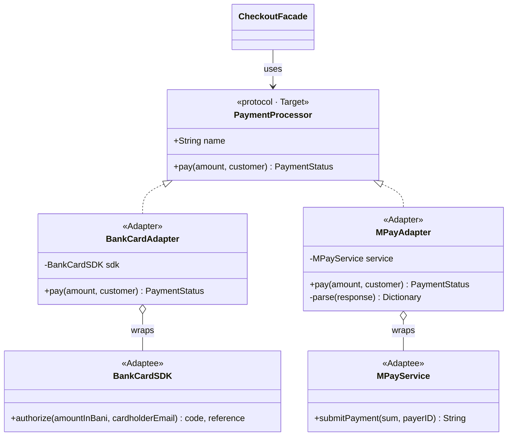

**Diagram — Adapter translating a call**

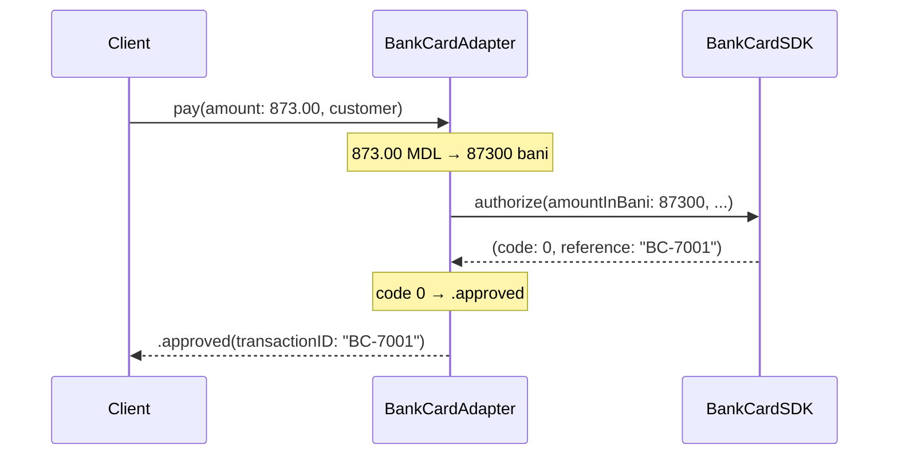

### 3.2 Decorator — order extras

📄 [`Sources/StructuralCore/Decorator/OrderItem.swift`](../Sources/StructuralCore/Decorator/OrderItem.swift) · 📄 [`Sources/StructuralCore/Decorator/ItemDecorators.swift`](../Sources/StructuralCore/Decorator/ItemDecorators.swift)

**Problem.** Any book in the cart can receive optional extras: gift wrapping (+25 MDL), express delivery (+60 MDL), insurance (+2%) and a student discount (−10%). Modelling each combination as a subclass (`GiftWrappedExpressBook`, `DiscountedInsuredBook`, …) explodes quickly: four extras already give 15 combinations. A single class with four Boolean flags and an `if` for each would have to be edited for every new extra.

**Solution.** `OrderItem` is the **component** interface (book, description, price). `BookItem` is the **concrete component**, a book with no extras. Every **decorator** is itself an `OrderItem` *and* holds the `OrderItem` it wraps. It forwards the call to the wrapped item and adds its own part on top. Decorators can be stacked in any number and order at runtime; a protocol extension adds fluent helpers:

```swift
BookItem(swiftBook).studentDiscount().giftWrapped().express()   // 320 → 288 → 313 → 373 MDL
```

```swift
// DECORATOR — the component and the concrete component
//
// Every line in the cart is an OrderItem: it has a description and a price.
// A plain book is the simplest item. Extras (gift wrap, express delivery,
// insurance, discounts) are added by wrapping it in decorators.

public protocol OrderItem {
    var book: Book { get }
    var description: String { get }
    var price: Double { get }
}

/// Concrete component: a book with no extras.
public struct BookItem: OrderItem {
    public let book: Book
    public init(_ book: Book) { self.book = book }
    public var description: String { book.title }
    public var price: Double { book.price }
}
```

```swift
// DECORATOR — the decorators
//
// Each decorator IS an OrderItem and HAS an OrderItem (the wrapped one).
// It forwards the call to the wrapped item and adds its own behaviour on
// top. Decorators can be stacked in any number and any order at runtime:
//
//   BookItem(swift).studentDiscount().giftWrapped().express()
//
// Without decorators we would need a subclass for every combination
// (GiftWrappedExpressBook, DiscountedInsuredBook, ...): 4 extras already
// give 15 combinations.

public struct GiftWrapped: OrderItem {
    let wrapped: OrderItem
    public var book: Book { wrapped.book }
    public var description: String { wrapped.description + " + gift wrap" }
    public var price: Double { wrapped.price + 25 }
}

public struct ExpressDelivery: OrderItem {
    let wrapped: OrderItem
    public var book: Book { wrapped.book }
    public var description: String { wrapped.description + " + express delivery" }
    public var price: Double { wrapped.price + 60 }
}

public struct Insured: OrderItem {
    let wrapped: OrderItem
    public var book: Book { wrapped.book }
    public var description: String { wrapped.description + " + insurance 2%" }
    public var price: Double { wrapped.price * 1.02 }
}

public struct StudentDiscount: OrderItem {
    let wrapped: OrderItem
    public var book: Book { wrapped.book }
    public var description: String { wrapped.description + " - student discount 10%" }
    public var price: Double { wrapped.price * 0.90 }
}

/// Fluent helpers, so decorators read like a sentence.
public extension OrderItem {
    func giftWrapped() -> OrderItem { GiftWrapped(wrapped: self) }
    func express() -> OrderItem { ExpressDelivery(wrapped: self) }
    func insured() -> OrderItem { Insured(wrapped: self) }
    func studentDiscount() -> OrderItem { StudentDiscount(wrapped: self) }
}
```

**Diagram — Decorator class structure**

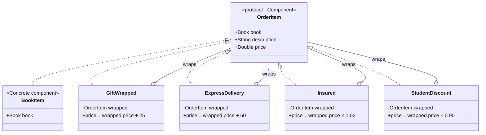

**Diagram — Decorators wrapped around one book**

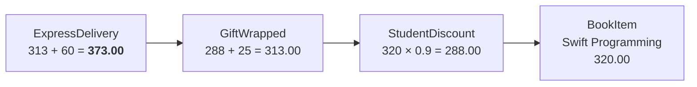

> **The order of decorators matters.** A discount applied after gift wrapping, (520 + 25) × 0.9 = **490.50 MDL**, is not the same as one applied before it, 520 × 0.9 + 25 = **493.00 MDL**. The demo and the unit tests show both cases.

### 3.3 Facade — CheckoutFacade

📄 [`Sources/StructuralCore/Facade/Subsystems.swift`](../Sources/StructuralCore/Facade/Subsystems.swift) · 📄 [`Sources/StructuralCore/Facade/CheckoutFacade.swift`](../Sources/StructuralCore/Facade/CheckoutFacade.swift)

**Problem.** Placing an order needs five subsystems in the right order: check stock in `Inventory`, compute the total of the (decorated) items, charge through a `PaymentProcessor`, reserve the stock, create an invoice with `InvoiceGenerator` and send it with `EmailService`. Every failure must stop the process at the right point. A declined payment must not reserve stock, and an out-of-stock item must not be charged. If every screen did this itself, the logic would be duplicated and easy to get wrong.

**Solution.** `CheckoutFacade` offers **one method**, `placeOrder(items:customer:payWith:)`, and runs the whole sequence behind it, returning a simple `CheckoutResult` (success with order number, total and transaction, or failure with a reason). The subsystems stay public, so code that needs fine control can still use them directly; the facade only makes the common case simple. The facade depends on the `PaymentProcessor` and `OrderItem` abstractions, so it works with any adapter and any combination of decorators.

```swift
// FACADE — the subsystems
//
// Placing an order touches several independent parts of the shop. Each one
// is simple on its own, but the client would have to call them in the right
// order and handle every failure in between.

/// Keeps how many copies of each book are in stock.
public final class Inventory {
    private var stock: [String: Int]

    public init(stock: [String: Int]) {
        self.stock = stock
    }

    public func isAvailable(_ book: Book) -> Bool {
        (stock[book.title] ?? 0) > 0
    }

    public func reserve(_ book: Book) {
        stock[book.title] = max(0, (stock[book.title] ?? 0) - 1)
    }

    public func count(of title: String) -> Int {
        stock[title] ?? 0
    }
}

/// Builds the text of an invoice.
public struct InvoiceGenerator {
    public init() {}

    public func makeInvoice(number: String, customer: String, items: [OrderItem],
                            total: Double, paidWith: String, transactionID: String) -> String {
        var lines = ["INVOICE \(number) - \(customer)"]
        for item in items {
            lines.append("  \(item.description): \(money(item.price))")
        }
        lines.append("  TOTAL: \(money(total)) (paid via \(paidWith), \(transactionID))")
        return lines.joined(separator: "\n")
    }
}

public struct Email: Equatable {
    public let to: String
    public let subject: String
    public let body: String
}

/// Sends emails (here: keeps them in an outbox).
public final class EmailService {
    public private(set) var outbox: [Email] = []
    public init() {}

    public func send(to: String, subject: String, body: String) {
        outbox.append(Email(to: to, subject: subject, body: body))
    }
}
```

```swift
// FACADE
//
// CheckoutFacade gives the client ONE simple method, placeOrder(...), and
// hides the subsystems behind it: stock check, price calculation (Decorator
// items), payment (Adapter processors), stock reservation, invoice and email.
//
// The subsystems are still public. Code that needs fine control can use
// them directly; the facade only makes the common case simple.

public enum CheckoutResult: Equatable {
    case success(orderNumber: String, total: Double, transactionID: String)
    case failure(reason: String)
}

public final class CheckoutFacade {
    private let inventory: Inventory
    private let invoices: InvoiceGenerator
    public let emailService: EmailService
    private var lastOrderNumber = 2000

    public init(inventory: Inventory,
                invoices: InvoiceGenerator = InvoiceGenerator(),
                emailService: EmailService = EmailService()) {
        self.inventory = inventory
        self.invoices = invoices
        self.emailService = emailService
    }

    public func placeOrder(items: [OrderItem], customer: String,
                           payWith processor: PaymentProcessor) -> CheckoutResult {
        // 1. Stock
        guard !items.isEmpty else {
            return .failure(reason: "the cart is empty")
        }
        for item in items where !inventory.isAvailable(item.book) {
            return .failure(reason: "'\(item.book.title)' is out of stock")
        }

        // 2. Price (each item may be decorated)
        let total = items.reduce(0) { $0 + $1.price }

        // 3. Payment (through any adapter)
        let status = processor.pay(amount: total, customer: customer)
        guard case .approved(let transactionID) = status else {
            if case .declined(let reason) = status {
                return .failure(reason: "payment declined by \(processor.name): \(reason)")
            }
            return .failure(reason: "payment failed")
        }

        // 4. Reserve stock, number the order, invoice and notify
        items.forEach { inventory.reserve($0.book) }
        lastOrderNumber += 1
        let number = "BK-\(lastOrderNumber)"
        let invoice = invoices.makeInvoice(number: number, customer: customer, items: items,
                                           total: total, paidWith: processor.name,
                                           transactionID: transactionID)
        emailService.send(to: customer,
                          subject: "Order \(number) confirmed (\(money(total)))",
                          body: invoice)
        return .success(orderNumber: number, total: total, transactionID: transactionID)
    }
}
```

**Diagram — Facade class structure**

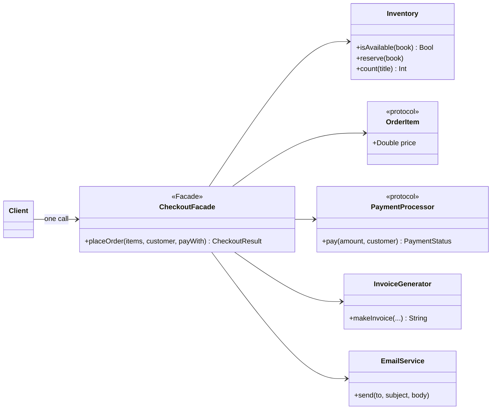

**Diagram — Facade orchestrating the subsystems**

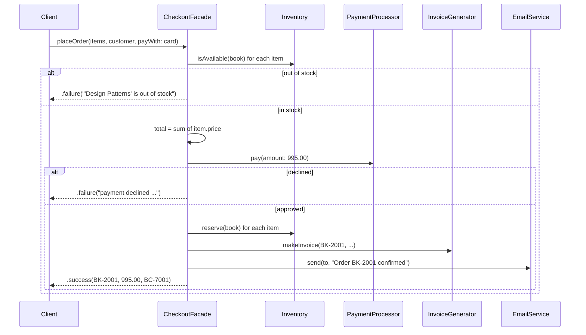

## 4. Testing and results

The `StructuralTests` target checks each pattern with XCTest:

| Pattern | Test | What it proves |
|---|---|---|
| Adapter | `testBankCardAdapterConvertsMDLToBani` | 873.50 MDL is sent as exactly 87 350 bani; code 0 → approved |
| Adapter | `testBankCardAdapterMapsCode51ToDeclined` | code 51 → "insufficient funds (code 51)" |
| Adapter | `testMPayAdapterParsesTextResponse` | text response → approved / "limit exceeded" |
| Adapter | `testClientCodeWorksWithAnyAdapter` | client code only knows `PaymentProcessor` |
| Decorator | `testDecoratorsStack` | 100 + 25 + 60 = 185 MDL, the original book is kept |
| Decorator | `testOrderOfDecoratorsMatters` | (100 + 25) × 0.9 = 112.50 vs 100 × 0.9 + 25 = 115 |
| Decorator | `testInsurance` | +2% → 102 MDL |
| Facade | `testSuccessfulOrderReservesStockAndSendsEmail` | success → stock −1, one email |
| Facade | `testOutOfStockNeverCallsPayment` | a spy processor is never called |
| Facade | `testDeclinedPaymentKeepsStockAndSendsNothing` | nothing reserved, no email |

Running `swift run StructuralDemo` produces the output below. In the **Adapter** section the same two calls go to two completely different APIs. In the **Decorator** section prices are built from layers. In the **Facade** section four orders show the success path and both failure paths: Order 2 fails because the only copy of *Design Patterns* was sold in Order 1, and Order 4 is declined by the card limit, so its stock remains untouched.

```
========== ADAPTER - two foreign payment APIs behind one interface ==========
[Bank card] 873.00 MDL -> approved, transaction BC-7001
[MPay] 873.00 MDL -> approved, transaction MP-5001
[Bank card] 7500.00 MDL -> declined: insufficient funds (code 51)
[MPay] 7500.00 MDL -> approved, transaction MP-5002

========== DECORATOR - extras wrapped around a book at runtime ==========
  Clean Code: 450.00 MDL
  Design Patterns + gift wrap: 545.00 MDL
  Design Patterns + insurance 2%: 530.40 MDL
  Swift Programming - student discount 10% + gift wrap + express delivery: 373.00 MDL

The order of decorators matters:
  Design Patterns + gift wrap - student discount 10%: 490.50 MDL
  Design Patterns - student discount 10% + gift wrap: 493.00 MDL

========== FACADE - one call places the whole order ==========
Order 1 (augustin@example.md, Bank card): SUCCESS BK-2001, 995.00 MDL, transaction BC-7001
Order 2 (ana@example.md, Bank card): FAILED: 'Design Patterns' is out of stock
Order 3 (student@utm.md, MPay): SUCCESS BK-2002, 465.00 MDL, transaction MP-5001
Order 4 (collector@example.md, Bank card): FAILED: payment declined by Bank card: insufficient funds (code 51)

Emails sent:
  To augustin@example.md: Order BK-2001 confirmed (995.00 MDL)
  To student@utm.md: Order BK-2002 confirmed (465.00 MDL)

First invoice:
INVOICE BK-2001 - augustin@example.md
  Clean Code: 450.00 MDL
  Design Patterns + gift wrap: 545.00 MDL
  TOTAL: 995.00 MDL (paid via Bank card, BC-7001)

Stock left: Clean Code 1, Design Patterns 0, Swift Programming 0, Collector's Edition 1
```

**How to run:**

```bash
cd lab2
swift run StructuralDemo
swift test
```

In Xcode: **File → Open… → `lab2/Package.swift`**, scheme **StructuralDemo** → ⌘R to run, ⌘U for tests.

## 5. The other structural patterns

### 5.1 Bridge

Bridge splits one large hierarchy into **two independent ones**, an abstraction and an implementation, connected by a reference (the "bridge"). Without it, 2 report types × 2 formats need 4 classes (`SalesPDF`, `SalesCSV`, `StockPDF`, `StockCSV`), and each new format adds a class per report. With Bridge, a new format is one class.

```swift
protocol ReportRenderer {                        // implementor
    func render(title: String, rows: [String]) -> String
}
struct PDFRenderer: ReportRenderer { ... }
struct CSVRenderer: ReportRenderer { ... }

class Report {                                    // abstraction
    let renderer: ReportRenderer                  // the bridge
    init(renderer: ReportRenderer) { self.renderer = renderer }
    func export() -> String { fatalError("override") }
}
final class SalesReport: Report {
    override func export() -> String { renderer.render(title: "Sales", rows: [...]) }
}
SalesReport(renderer: CSVRenderer()).export()
```

**Diagram — Bridge**

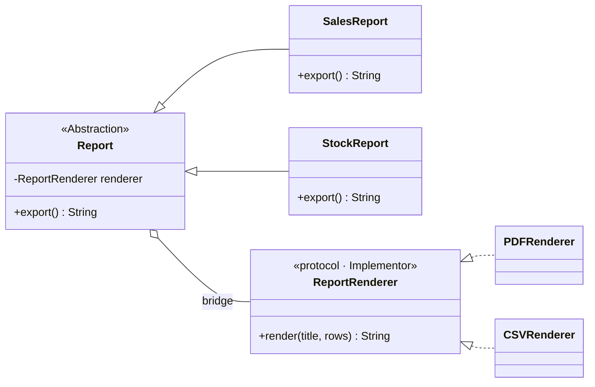

### 5.2 Composite

Composite lets **single objects and groups** be treated the same way through one interface, forming a tree. A bundle of books has a price like a single book does, and a bundle can contain other bundles.

```swift
protocol CartComponent { var name: String { get }; var price: Double { get } }

struct SingleBook: CartComponent { let name: String; let price: Double }   // leaf

final class BookBundle: CartComponent {                                    // composite
    let name: String
    private var children: [CartComponent] = []
    init(name: String) { self.name = name }
    func add(_ c: CartComponent) { children.append(c) }
    var price: Double { children.reduce(0) { $0 + $1.price } * 0.85 }      // -15% bundle
}
let starter = BookBundle(name: "Swift starter pack")
starter.add(SingleBook(name: "Swift Programming", price: 320))
starter.add(SingleBook(name: "Clean Code", price: 450))
starter.price   // 654.50, same call as for one book
```

**Diagram — Composite**

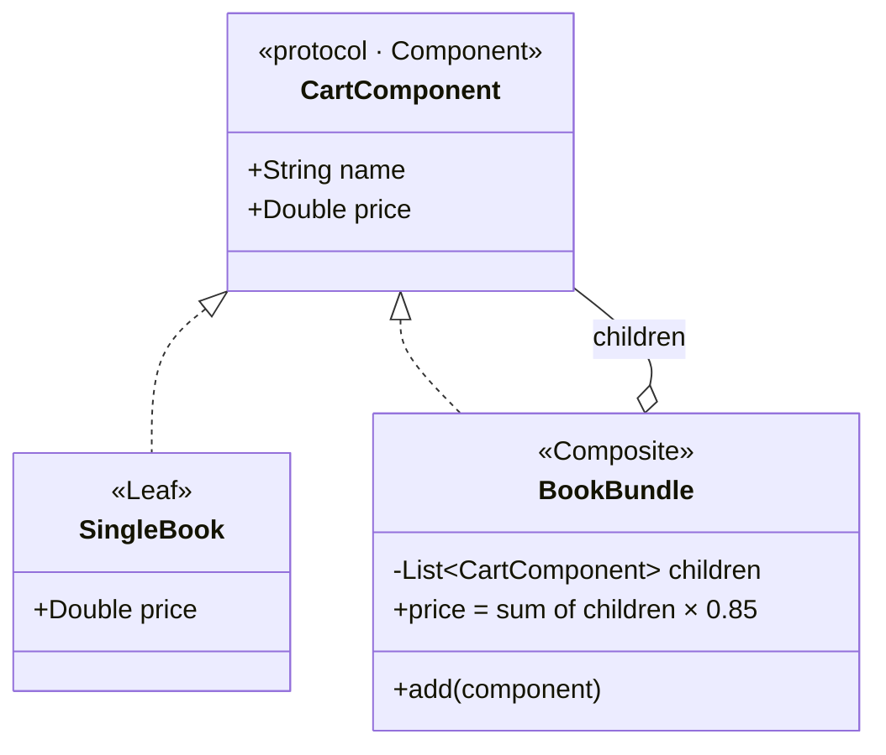

### 5.3 Flyweight

Flyweight saves memory when there are very many similar objects. The heavy state that many objects have in common (**intrinsic** state) is stored once and **shared**. Only the small unique part (**extrinsic** state) is kept per object. A catalogue of 100 000 book cards from 20 publishers needs only 20 cover styles (font, logo, colours), not 100 000.

```swift
final class CoverStyle {                       // flyweight: shared, immutable
    let font: String; let logo: Data; let colors: String
}
final class CoverStyleFactory {
    private var cache: [String: CoverStyle] = [:]
    func style(for publisher: String) -> CoverStyle {
        if let s = cache[publisher] { return s }  // reuse
        let s = CoverStyle(...)                   // create once
        cache[publisher] = s
        return s
    }
}
struct BookCard { let title: String; let price: Double; let style: CoverStyle }
```

**Diagram — Flyweight**

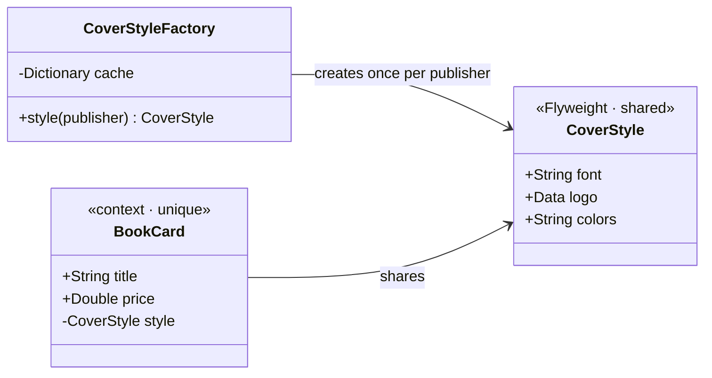

### 5.4 Proxy

A Proxy has **the same interface** as the real object and stands in front of it to **control access**. It can create the real object only when it is first needed (virtual proxy), check permissions (protection proxy), cache results, log calls or talk to a remote server. The client does not notice the difference.

```swift
protocol BookPreview { func pages() -> [String] }

final class RealBookPreview: BookPreview {     // expensive: downloads the PDF
    func pages() -> [String] { ... }
}
final class BookPreviewProxy: BookPreview {
    private lazy var real = RealBookPreview()  // created only when needed
    private let hasAccess: Bool
    init(hasAccess: Bool) { self.hasAccess = hasAccess }
    func pages() -> [String] {
        hasAccess ? real.pages() : Array(real.pages().prefix(3))   // free preview: 3 pages
    }
}
```

**Diagram — Proxy**

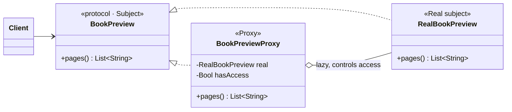

### Wrapper-like patterns compared

| | Adapter | Decorator | Proxy | Facade |
|---|---|---|---|---|
| **Interface** | Changes it to the one the client expects | Same as the wrapped object | Same as the real object | New, simpler one |
| **Purpose** | Make incompatible code work together | Add behaviour | Control access | Hide complexity |
| **Wraps** | One adaptee | One component (stackable) | One real subject | A whole subsystem |

## Conclusion

In this laboratory work three structural design patterns were implemented in Swift and combined in one checkout flow of the bookstore application.

The **Adapter** made two third-party payment APIs with incompatible interfaces (amounts in bani with numeric codes, and amounts as text with text responses) usable through one `PaymentProcessor` interface, so the rest of the shop never depends on a vendor library.

The **Decorator** replaced a combinatorial explosion of subclasses with small wrappers that are stacked at runtime. It also showed that the order of decorators can change the result.

The **Facade** hid five subsystems behind a single `placeOrder` call and placed the failure handling in one place: an out-of-stock item is never charged, and a declined payment never reserves stock.

Bridge, Composite, Flyweight and Proxy were also studied. All structural patterns rely mainly on **composition over inheritance**: they combine objects behind interfaces so that each part can change, be added or be replaced without affecting the rest.

## Bibliography

1. Gamma, E., Helm, R., Johnson, R., Vlissides, J. *Design Patterns: Elements of Reusable Object-Oriented Software*. Addison-Wesley, 1994.
2. Shvets, A. *Dive Into Design Patterns*. refactoring.guru, 2021.
3. Apple Inc. *The Swift Programming Language — Protocols, Extensions, Enumerations*. docs.swift.org.

**Repository:** https://github.com/Afyze/tmps-2026-AugustinCarazanu/tree/main/lab2
