# Laboratory Work No. 3 — Behavioral Design Patterns

| | |
|---|---|
| **Discipline** | Techniques and Mechanisms of Software Design (TMPS) |
| **Student** | Augustin Carazanu, FAF-243 |
| **Checked by** | assist. univ. Daniel Istrati |
| **Language** | Swift 5.9 (Swift Package Manager, XCTest) |
| **Patterns implemented** | State, Command, Observer (built on Lab 2: Facade, Decorator, Proxy/Adapter; Lab 1: Singleton) |

---

## 1. Domain description

The project is the **online bookstore** from Lab 0 – Lab 2. Lab 3 adds what happens **after checkout**: the **order lifecycle** in the warehouse.

An order is placed through Lab 2's `CheckoutFacade` (stock, price of the decorated items, payment, order number from Lab 1's Singleton). It then moves through **Placed → Packed → Shipped → Delivered** and can be **Cancelled** only before it is shipped. A warehouse operator drives it by typing actions in a console (`pack`, `ship`, `deliver`, `cancel`). An action can be run now or **queued** and run later, and a mistaken action can be **undone**. Every status change is announced to whoever is interested at that moment: the **customer email**, an **audit log** and the **courier dispatch**, which books a pickup when an order ships and cancels it when the shipment is undone. The operator can turn these notifications on and off **while the program runs**.

### How the patterns work together

One execution path passes through all three patterns: **user input → Command → State → Observers**.

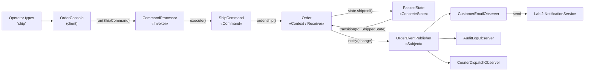

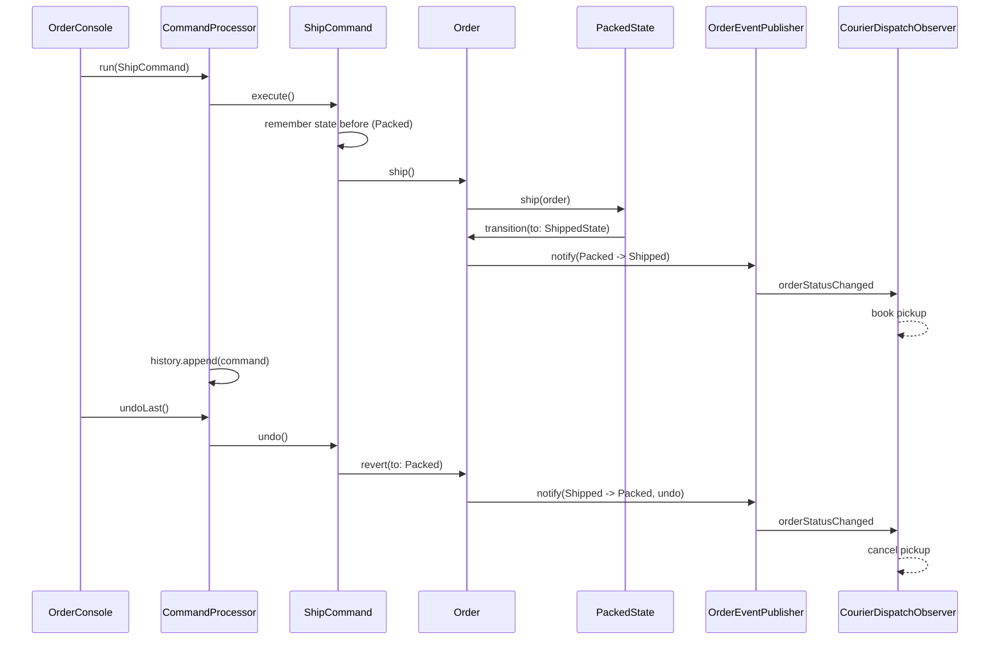

### Building on Lab 2 (and Lab 1)

`lab3/Package.swift` depends on the `lab1` and `lab2` packages. Nothing from them is copied.

- **Facade (Lab 2):** orders enter the lifecycle through `CheckoutFacade.placeOrder(...)`, wrapped by [`OrderIntake`](../Sources/BehavioralCore/Integration/OrderIntake.swift). A failed checkout creates no order.
- **Decorator (Lab 2):** the order lines are decorated `OrderItem`s, e.g. `BookItem(book).giftWrapped()`.
- **Proxy/Adapter (Lab 2):** the checkout prices in a currency through the `ExchangeRateProvider` chain.
- **Lab 2 subsystem interface:** `CustomerEmailObserver` sends through Lab 2's `NotificationService` (`EmailOutbox`).
- **Singleton (Lab 1):** the order number (`BK-1001`) comes from `OrderNumberGenerator.shared` through the facade.

### Project structure

```
lab3/
├── Package.swift                     depends on ../lab1 and ../lab2
├── Sources/
│   ├── BehavioralCore/
│   │   ├── Domain/                   OrderEvents.swift (OrderStatusChange, OrderError)
│   │   ├── Patterns/
│   │   │   ├── State/                OrderState.swift, ConcreteStates.swift, Order.swift (context)
│   │   │   ├── Command/              OrderCommand.swift (interface + base), CommandProcessor.swift (invoker)
│   │   │   └── Observer/             OrderObserving.swift (interfaces), OrderEventPublisher.swift (subject)
│   │   ├── Commands/                 OrderCommands.swift (Pack, Ship, Deliver, Cancel)
│   │   ├── Observers/                CustomerEmailObserver, AuditLogObserver, CourierDispatchObserver
│   │   └── Integration/              OrderIntake.swift (Lab 2 checkout -> Order)
│   └── BehavioralDemo/               main.swift, OrderConsole.swift (client), DemoScenario.swift
└── Tests/BehavioralTests/            State-, Command-, Observer-, IntegrationTests.swift, Fixtures.swift
```

---

## 2. Patterns

### 2.1 State — the order lifecycle

**Problem in this project.** What an operator may do with an order depends on where the order is. A placed order can be packed or cancelled. A shipped order can only be delivered. A delivered order can do nothing. With a status enum, every action would need a `switch` over all statuses inside `Order`. Adding a status (for example *Returned*) would mean editing every `switch`, and an `if` forgotten in one place would let a delivered order be cancelled. With State, **each status is a class** that allows only its own actions and decides the next status.

**Roles.** Context: `Order` · State interface: `OrderState` (with default "forbidden" implementations) · Concrete states: `PlacedState`, `PackedState`, `ShippedState`, `DeliveredState`, `CancelledState`.

#### Class diagram

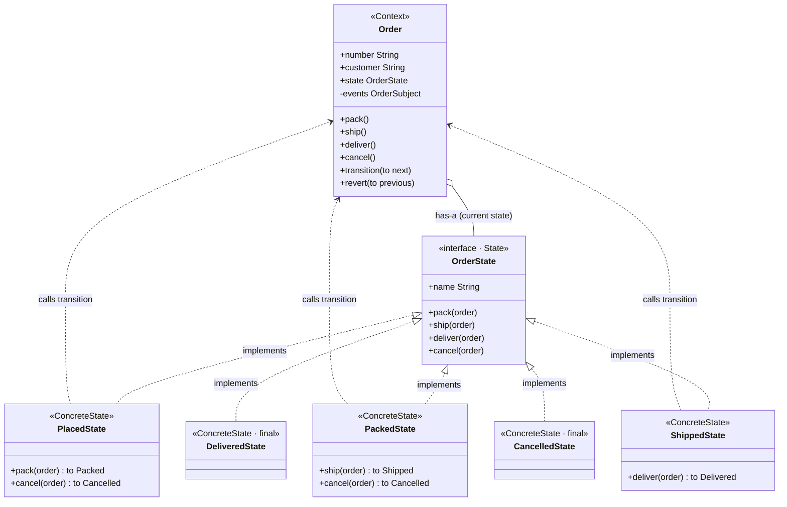

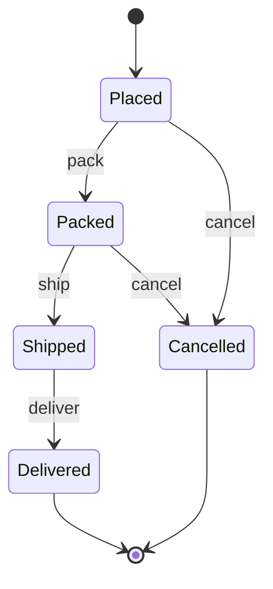

#### Code

📄 [`Order.swift`](../Sources/BehavioralCore/Patterns/State/Order.swift) · [`OrderState.swift`](../Sources/BehavioralCore/Patterns/State/OrderState.swift) · [`ConcreteStates.swift`](../Sources/BehavioralCore/Patterns/State/ConcreteStates.swift)

```swift
// Context: pure delegation to the current state
public func pack() throws { try state.pack(self) }
public func ship() throws { try state.ship(self) }
public func deliver() throws { try state.deliver(self) }
public func cancel() throws { try state.cancel(self) }

// State interface: an action is forbidden unless a concrete state allows it
public extension OrderState {
    func ship(_ order: Order) throws { throw OrderError.forbidden(action: "ship", state: name) }
    // pack, deliver, cancel: the same
}

// Concrete states: each one allows only its own actions and names the next state
public struct PackedState: OrderState {
    public let name = "Packed"
    public func ship(_ order: Order) throws { order.transition(to: ShippedState()) }
    public func cancel(_ order: Order) throws { order.transition(to: CancelledState()) }
}

public struct ShippedState: OrderState {
    public let name = "Shipped"
    public func deliver(_ order: Order) throws { order.transition(to: DeliveredState()) }
}
```

`Order` never checks its own status: every action is forwarded to the current state object. The protocol extension rejects every action by default, and each concrete state overrides only what it allows and decides the next state. A new status is therefore a new type, and no `switch` has to be edited.

#### Unit tests

| Test | What it checks |
|---|---|
| `StateTests.testValidTransitions` | The allowed path Placed → Packed → Shipped → Delivered. |
| `StateTests.testForbiddenTransitionIsRejected` | `ship` on a Placed order throws `forbidden(ship, Placed)` and the state stays Placed. |
| `StateTests.testCancelOnlyBeforeShipping` | Cancel works from Placed and Packed but is rejected from Shipped. |
| `StateTests.testFinalStatesRejectEverything` | Delivered and Cancelled reject all four actions and do not change. |

Test log: see [section 3](#3-test-run).

---

### 2.2 Command — operator actions with queue, history and undo

**Problem in this project.** Operator actions must be **queued** (prepare a batch, run it at the end of the shift), **recorded** (what was done to the order) and **undoable** (an operator shipped by mistake). If the console called `order.ship()` directly, there would be nothing to put in a queue, nothing to keep in a history and no information on how to undo. Making each action an object solves all three. The command holds **no business rules**: whether an action is allowed is still decided by the order's State.

**Roles.** Command interface: `OrderCommand` · Base command: `OrderTransitionCommand` (remembers the state before, undo puts it back) · Concrete commands: `PackCommand`, `ShipCommand`, `DeliverCommand`, `CancelCommand` · Receiver: `Order` · Invoker: `CommandProcessor` · Client: `OrderConsole`.

#### Class diagram

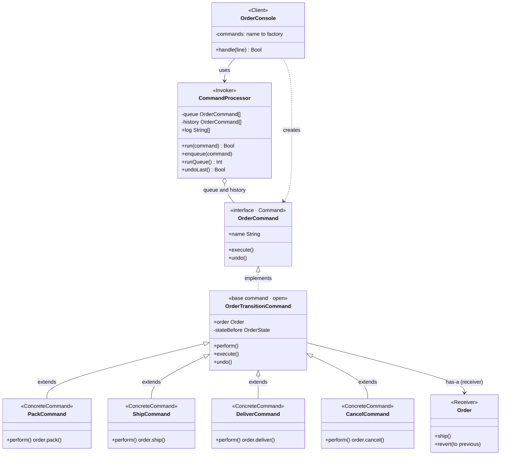

#### Code

📄 [`OrderCommand.swift`](../Sources/BehavioralCore/Patterns/Command/OrderCommand.swift) · [`CommandProcessor.swift`](../Sources/BehavioralCore/Patterns/Command/CommandProcessor.swift) · [`OrderCommands.swift`](../Sources/BehavioralCore/Commands/OrderCommands.swift)

```swift
// Base command: the execute/undo pair
public final func execute() throws {
    let before = order.state
    try perform()                          // may throw: the state rejected it
    stateBefore = before                   // remembered only if it succeeded
}

public final func undo() {
    guard let before = stateBefore else { return }
    order.revert(to: before)
    stateBefore = nil
}

// Concrete command: one call to the receiver
public final class ShipCommand: OrderTransitionCommand {
    public override var name: String { "ship \(order.number)" }
    public override func perform() throws { try order.ship() }
}

// Invoker: only successful commands enter the history; undo goes backwards
public func run(_ command: OrderCommand) -> Bool {
    do {
        try command.execute()
        history.append(command)
        log.append("done: \(command.name)")
        return true
    } catch {
        log.append("rejected: \(command.name) - \(error)")
        return false
    }
}
```

`execute()` saves the order's state before asking the receiver to act, so `undo()` knows exactly where to go back. The invoker handles every command through `OrderCommand`: it can run it, queue it, keep it in the history and undo it in reverse order, without knowing which action it is. A new command is a new subclass (the tests add `PackAndShipCommand` without editing anything).

#### Unit tests

| Test | What it checks |
|---|---|
| `CommandTests.testExecuteThenUndoRestoresState` | `PackCommand` moves Placed → Packed, and undo restores Placed. |
| `CommandTests.testUndoGoesBackThroughHistory` | After pack and ship, two undos go back Shipped → Packed → Placed; a third finds nothing. |
| `CommandTests.testRejectedCommandIsNotInHistory` | A rejected `DeliverCommand` is not recorded, so undo skips it. |
| `CommandTests.testQueueRunsInOrderAndStopsAtFailure` | The queue `pack, deliver, ship` runs pack, stops at the rejected deliver and drops the rest. |
| `CommandTests.testNewCommandWithoutEditingExistingClasses` | A new `PackAndShipCommand` written in the test file works with the invoker and its undo. |

Test log: see [section 3](#3-test-run).

---

### 2.3 Observer — status notifications

**Problem in this project.** Several independent parts of the shop must react to a status change: the customer gets an email, the audit log records it and the courier is booked when the order ships. If `Order` called them directly, it would depend on email, logging and courier code, and every new reaction (for example an SMS) would mean editing `Order`. Also, the operator wants to switch notifications **on and off while the program runs**. With Observer, the order only tells its subject that something changed, and whoever is subscribed at that moment reacts.

**Roles.** Subject interface: `OrderSubject` · Concrete subject: `OrderEventPublisher` · Observer interface: `OrderObserver` · Concrete observers: `CustomerEmailObserver`, `AuditLogObserver`, `CourierDispatchObserver` · Event: `OrderStatusChange`.

#### Class diagram

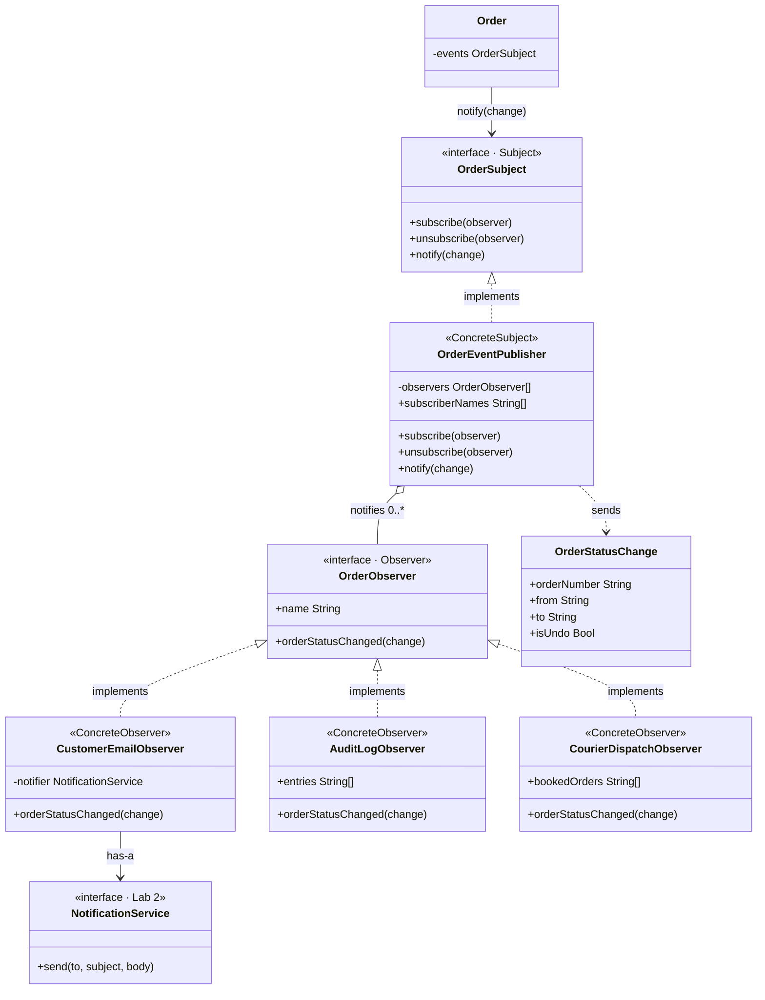

#### Code

📄 [`OrderEventPublisher.swift`](../Sources/BehavioralCore/Patterns/Observer/OrderEventPublisher.swift) · [`OrderObserving.swift`](../Sources/BehavioralCore/Patterns/Observer/OrderObserving.swift) · [`CourierDispatchObserver.swift`](../Sources/BehavioralCore/Observers/CourierDispatchObserver.swift)

```swift
public final class OrderEventPublisher: OrderSubject {
    private var observers: [OrderObserver] = []

    public func subscribe(_ observer: OrderObserver) {
        guard !observers.contains(where: { $0 === observer }) else { return }   // no duplicates
        observers.append(observer)
    }

    public func unsubscribe(_ observer: OrderObserver) {
        observers.removeAll { $0 === observer }
    }

    public func notify(_ change: OrderStatusChange) {
        let current = observers            // copy: an observer may unsubscribe while being notified
        for observer in current {
            observer.orderStatusChanged(change)
        }
    }
}

// A concrete observer reacts only to what it cares about
public func orderStatusChanged(_ change: OrderStatusChange) {
    if change.to == "Shipped" && !change.isUndo {
        bookedOrders.append(change.orderNumber)
    } else if change.from == "Shipped" && change.isUndo {
        bookedOrders.removeAll { $0 == change.orderNumber }
    }
}
```

The subject keeps a list of `OrderObserver`s and knows nothing else about them. `notify` loops over the observers subscribed at that moment, so they can join and leave at runtime. Observers only read the change and never modify the order, so a notification cannot trigger an endless update loop.

#### Unit tests

| Test | What it checks |
|---|---|
| `ObserverTests.testSubscribedNotifiedUnsubscribedNot` | Two observers get `Packed`. After one unsubscribes, only the other gets `Shipped`. |
| `ObserverTests.testNoDuplicateSubscriptions` | Subscribing twice still gives one notification. |
| `ObserverTests.testNotificationContent` | The change carries order number, customer, from, to and the undo flag. |
| `ObserverTests.testCourierReactsOnlyToShipping` | The courier ignores `Packed`, books on `Shipped` and cancels on the undo of shipping. |
| `ObserverTests.testEmailObserverUsesLab2Notifier` | The email goes out through Lab 2's `EmailOutbox` with subject "Order T-1 is now Packed". |

Test log: see [section 3](#3-test-run).

---

### 2.4 Runtime behaviour (advanced requirement A)

The behaviour changes while the program runs, driven by **user input**:
- `subscribe` and `unsubscribe` (`email`, `audit`, `courier`) attach and detach observers live;
- `pack`, `ship`, `deliver` and `cancel` move the order between states;
- `queue …`, `run-queue` and `undo` change what has been executed.

```bash
swift run BehavioralDemo --interactive        # type the commands yourself
swift run BehavioralDemo --script steps.txt   # the same commands from a file (configuration)
```

---

## 3. Test run

All tests run with one command from the `lab3` folder:

```bash
swift test
```

Run on macOS, 25.11.2026, Xcode toolchain:

```
Test Case '-[BehavioralTests.CommandTests testExecuteThenUndoRestoresState]' passed (0.001 seconds).
Test Case '-[BehavioralTests.CommandTests testNewCommandWithoutEditingExistingClasses]' passed (0.000 seconds).
Test Case '-[BehavioralTests.CommandTests testQueueRunsInOrderAndStopsAtFailure]' passed (0.000 seconds).
Test Case '-[BehavioralTests.CommandTests testRejectedCommandIsNotInHistory]' passed (0.000 seconds).
Test Case '-[BehavioralTests.CommandTests testUndoGoesBackThroughHistory]' passed (0.000 seconds).
	 Executed 5 tests, with 0 failures (0 unexpected) in 0.001 (0.002) seconds
Test Case '-[BehavioralTests.IntegrationTests testCommandChangesStateAndObserversAreNotified]' passed (0.000 seconds).
Test Case '-[BehavioralTests.IntegrationTests testFailedCheckoutCreatesNoOrder]' passed (0.000 seconds).
	 Executed 2 tests, with 0 failures (0 unexpected) in 0.000 (0.001) seconds
Test Case '-[BehavioralTests.ObserverTests testCourierReactsOnlyToShipping]' passed (0.000 seconds).
Test Case '-[BehavioralTests.ObserverTests testEmailObserverUsesLab2Notifier]' passed (0.000 seconds).
Test Case '-[BehavioralTests.ObserverTests testNoDuplicateSubscriptions]' passed (0.000 seconds).
Test Case '-[BehavioralTests.ObserverTests testNotificationContent]' passed (0.000 seconds).
Test Case '-[BehavioralTests.ObserverTests testSubscribedNotifiedUnsubscribedNot]' passed (0.000 seconds).
	 Executed 5 tests, with 0 failures (0 unexpected) in 0.001 (0.001) seconds
Test Case '-[BehavioralTests.StateTests testCancelOnlyBeforeShipping]' passed (0.000 seconds).
Test Case '-[BehavioralTests.StateTests testFinalStatesRejectEverything]' passed (0.000 seconds).
Test Case '-[BehavioralTests.StateTests testForbiddenTransitionIsRejected]' passed (0.000 seconds).
Test Case '-[BehavioralTests.StateTests testValidTransitions]' passed (0.000 seconds).
	 Executed 4 tests, with 0 failures (0 unexpected) in 0.001 (0.001) seconds
	 Executed 16 tests, with 0 failures (0 unexpected) in 0.003 (0.004) seconds
```

The two integration tests check the full chain: `testCommandChangesStateAndObserversAreNotified` places an order through Lab 2's facade, runs `pack`, `ship` and `undo` through the invoker, and checks the final state, the audit log and the 4 emails (1 checkout confirmation + 3 status changes). `testFailedCheckoutCreatesNoOrder` checks that an out-of-stock checkout raises `checkoutFailed` and creates no order.

## 4. Demo

`swift run BehavioralDemo` runs the built-in scenario. These are the same lines an operator would type with `--interactive`:

```
========== Lab 3 - order lifecycle (State + Command + Observer) ==========
Order BK-1001 placed through Lab 2's CheckoutFacade, state: Placed
> status
  BK-1001 is Placed; subscribed observers: none
> subscribe email
  email subscribed
> subscribe audit
  audit subscribed
> pack
  [email] to augustin@example.md: Order BK-1001 is now Packed
  [audit] BK-1001: Placed -> Packed
  done: pack BK-1001
> subscribe courier
  courier subscribed
> ship
  [email] to augustin@example.md: Order BK-1001 is now Shipped
  [audit] BK-1001: Packed -> Shipped
  [courier] pickup booked for BK-1001
  done: ship BK-1001
> undo
  [email] to augustin@example.md: Order BK-1001 is back to Packed (correction)
  [audit] BK-1001: Shipped -> Packed (undo)
  [courier] pickup cancelled for BK-1001
  undone: ship BK-1001
> unsubscribe email
  email unsubscribed
> queue ship
  queued: ship BK-1001
> queue deliver
  queued: deliver BK-1001
> run-queue
  [audit] BK-1001: Packed -> Shipped
  [courier] pickup booked for BK-1001
  [audit] BK-1001: Shipped -> Delivered
  done: ship BK-1001
  done: deliver BK-1001
> cancel
  rejected: cancel BK-1001 - cannot cancel an order that is Delivered
> history
  pack BK-1001, ship BK-1001, deliver BK-1001
> status
  BK-1001 is Delivered; subscribed observers: audit, courier
```

The output shows every requirement in one run:
- one command goes through Command → State → all subscribed Observers;
- undo also notifies the observers, and the courier cancels its pickup;
- after `unsubscribe email` no more emails are sent;
- the queue runs two commands in order;
- the State rejects cancelling a delivered order.

---

## 5. Open for extension

Each variant below is added with **new classes only**. For the console, add one line that registers the new name.

| New requirement | What to add | Existing classes edited |
|---|---|---|
| A *Returned* status after Delivered | `ReturnedState: OrderState`, and in `DeliveredState` one allowed action (`returnOrder`) | the state that allows it (that is its job) + the protocol gets the new action with a default "forbidden" |
| A new operator action (e.g. pack and ship at once) | `PackAndShipCommand: OrderTransitionCommand` | none (done in `CommandTests`) |
| SMS notification | `SMSObserver: OrderObserver` | none |
| Notify only on delivery | an observer that filters `change.to == "Delivered"` | none |

---

## 6. The other behavioral patterns (theory)

The order lifecycle needed State, Command and Observer. The remaining behavioral patterns are described below on the same bookstore, with a class diagram and a short sketch, together with the reason they were not part of this lab. Two of them already appear in a small form in the code (Template Method and Memento) and one is close to the console (Interpreter).

### 6.1 Strategy

**Idea.** Define a family of interchangeable algorithms behind one interface. The client chooses which one to use, and can change it at runtime.

**In the bookstore.** Shipping cost: standard (free over 500 MDL, otherwise 40), express (60), pickup from the shop (0). The cart does not know the formulas, it only calls `cost(for:)`.

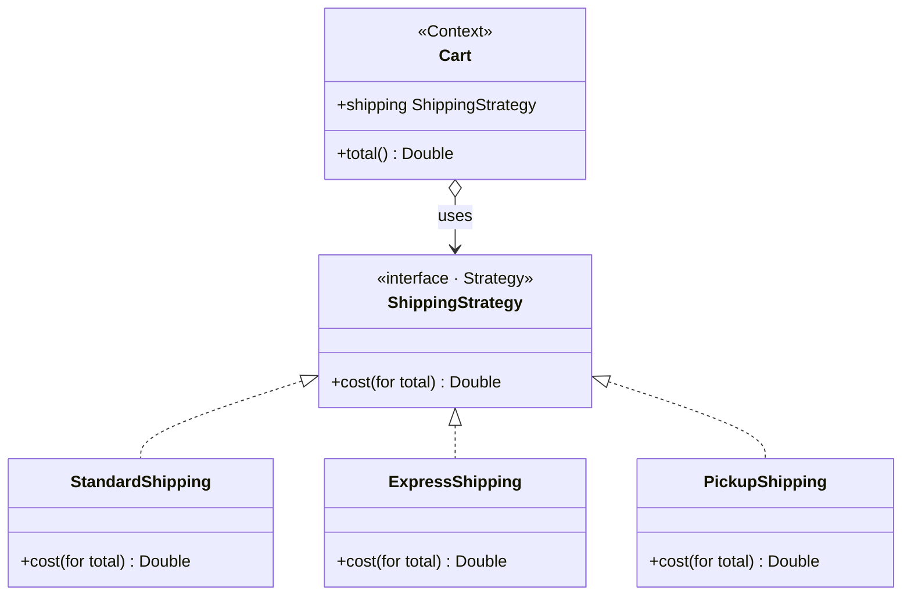

```swift
protocol ShippingStrategy { func cost(for total: Double) -> Double }

struct StandardShipping: ShippingStrategy { func cost(for t: Double) -> Double { t >= 500 ? 0 : 40 } }
struct ExpressShipping:  ShippingStrategy { func cost(for t: Double) -> Double { 60 } }
struct PickupShipping:   ShippingStrategy { func cost(for t: Double) -> Double { 0 } }

final class Cart {
    var items: [OrderItem] = []
    var shipping: ShippingStrategy = StandardShipping()
    func total() -> Double {
        let goods = items.reduce(0) { $0 + $1.price }
        return goods + shipping.cost(for: goods)
    }
}
cart.shipping = ExpressShipping()              // chosen by the client
```

**Difference from State.** The class diagram is the same shape. In State the state object changes the context itself (`PlacedState` moves the order to `PackedState`); in Strategy the client picks the algorithm and the strategies do not know each other.

**Why it was not used.** Lab 2 already models delivery as a decorator (`ExpressDelivery`). Strategy would replace it if the shop had to choose exactly one shipping method per order.

### 6.2 Template Method

**Idea.** A base class fixes the steps of an algorithm in one method; subclasses override only some steps.

**Already in the code, in a small form.** `OrderTransitionCommand.execute()` is `final`: it saves the state, calls `perform()`, and remembers the old state only on success. Each concrete command overrides only `perform()`. The sketch below shows a fuller example: exporting reports.

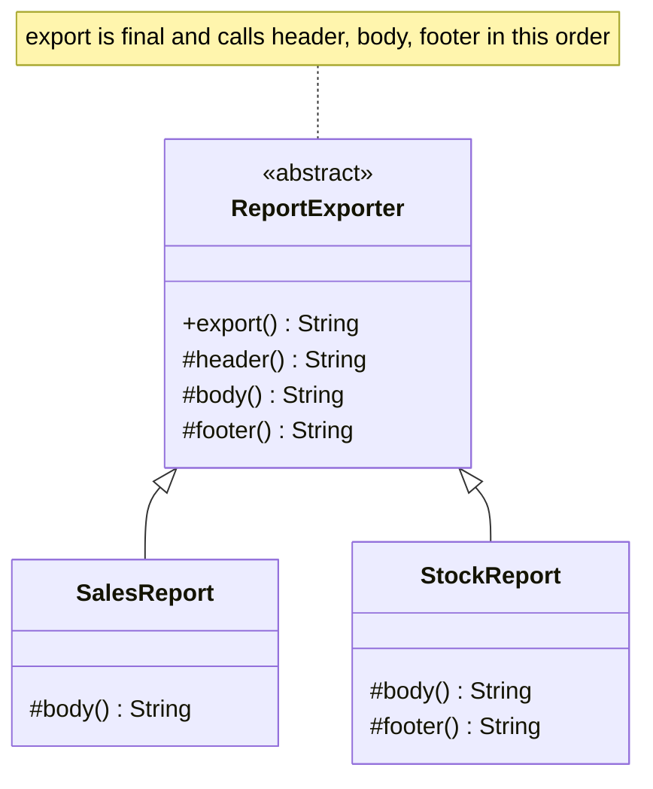

```swift
class ReportExporter {
    final func export() -> String {             // the template: order is fixed
        header() + body() + footer()
    }
    func header() -> String { "Online bookstore\n" }
    func body() -> String { fatalError("subclass must override") }
    func footer() -> String { "\n---" }
}

final class SalesReport: ReportExporter {
    let orders: [Receipt]
    init(orders: [Receipt]) { self.orders = orders }
    override func body() -> String { orders.map(\.text).joined(separator: "\n") }
}
```

**Difference from Strategy.** Template Method uses inheritance and varies *a step*; Strategy uses composition and replaces *the whole algorithm*.

### 6.3 Chain of Responsibility

**Idea.** Pass a request along a chain of handlers. Each handler either handles it (and stops the chain) or passes it to the next one.

**In the bookstore.** Before checkout, an order goes through checks: stock → card limit → delivery address → fraud check. The first check that fails stops the chain with a reason. A new check is a new handler inserted in the chain, the others do not change.

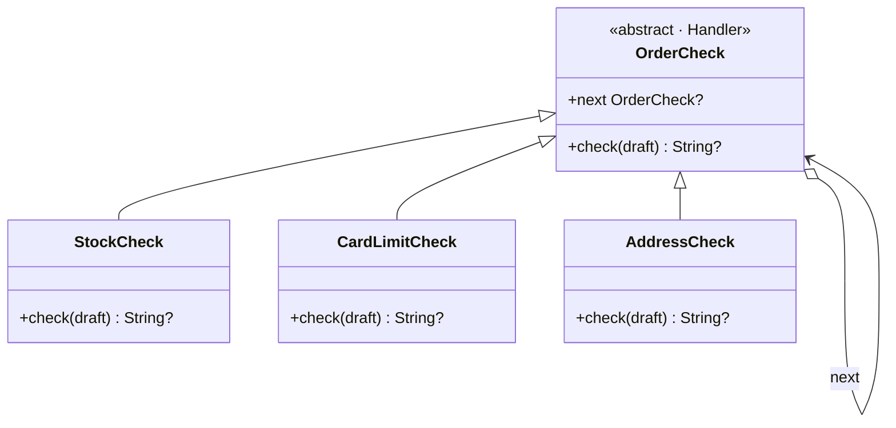

```swift
class OrderCheck {
    var next: OrderCheck?
    @discardableResult func then(_ handler: OrderCheck) -> OrderCheck { next = handler; return handler }
    func check(_ draft: OrderDraft) -> String? { next?.check(draft) }   // default: pass on
}

final class StockCheck: OrderCheck {
    let stock: StockService
    init(stock: StockService) { self.stock = stock }
    override func check(_ draft: OrderDraft) -> String? {
        if let missing = draft.items.first(where: { !stock.isAvailable($0.book) }) {
            return "'\(missing.book.title)' is out of stock"            // handled: stop
        }
        return super.check(draft)                                       // pass to next
    }
}

let chain = StockCheck(stock: stock)
chain.then(CardLimitCheck(limit: 5000)).then(AddressCheck())
let problem = chain.check(draft)                                        // nil = all passed
```

**Why it was not used.** In Lab 2 the facade does only two checks (stock and payment) in a fixed order. A chain becomes worth it when checks are many or configurable.

### 6.4 Iterator

**Idea.** Give sequential access to the elements of a collection without exposing how it is stored.

**In the bookstore.** The catalogue can be traversed page by page or only for one author, without the client knowing whether books live in an array, a dictionary or a remote API. In Swift the pattern is built into the language: `Sequence` + `IteratorProtocol`, used by `for … in`.

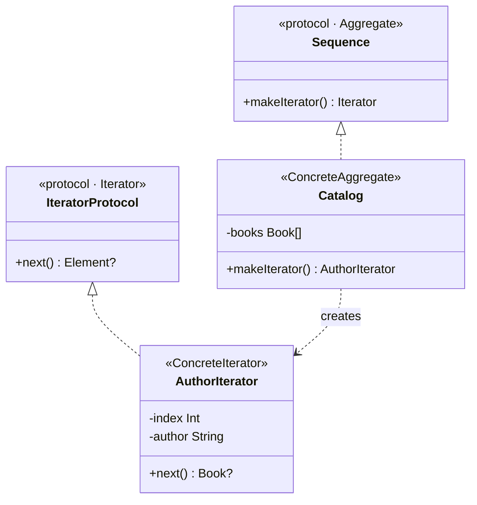

```swift
struct AuthorIterator: IteratorProtocol {
    let books: [Book]; let author: String
    private var index = 0
    init(books: [Book], author: String) { self.books = books; self.author = author }
    mutating func next() -> Book? {
        while index < books.count {
            defer { index += 1 }
            if books[index].author == author { return books[index] }
        }
        return nil
    }
}

struct BooksBy: Sequence {
    let catalog: [Book]; let author: String
    func makeIterator() -> AuthorIterator { AuthorIterator(books: catalog, author: author) }
}

for book in BooksBy(catalog: allBooks, author: "Robert C. Martin") { print(book.title) }
```

**Why it was not implemented separately.** Swift collections already are iterators; the project uses them everywhere (`for observer in current`, `items.reduce`). Writing a custom one adds nothing to the order lifecycle.

### 6.5 Mediator

**Idea.** Objects do not talk to each other directly; they talk only to a mediator, which coordinates them. This removes many-to-many dependencies.

**In the bookstore.** On the checkout screen the currency picker, the coupon field, the shipping picker and the "Pay" button influence each other (a new currency changes the total, a coupon changes the total, the button is enabled only when everything is valid). Each control only tells the mediator "I changed".

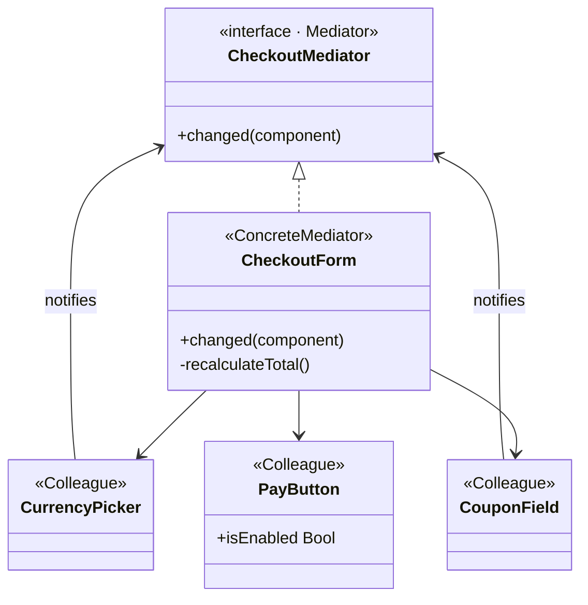

```swift
protocol CheckoutMediator: AnyObject { func changed(_ component: FormComponent) }

final class CheckoutForm: CheckoutMediator {
    let currency = CurrencyPicker(), coupon = CouponField(), pay = PayButton()
    init() { [currency, coupon].forEach { $0.mediator = self } }

    func changed(_ component: FormComponent) {
        if component === currency || component === coupon { recalculateTotal() }
        pay.isEnabled = coupon.isValid && currency.selected != nil
    }
    private func recalculateTotal() { /* uses Lab 2 rates and decorators */ }
}
```

**Difference from Observer.** Observer is one-to-many in one direction (the order announces, observers react and never answer). In a Mediator the components communicate both ways, but only through the centre.

**Why it was not used.** The project is a console application without interdependent UI components.

### 6.6 Memento

**Idea.** Capture an object's internal state in a snapshot, without exposing that state, so the object can be restored later.

**Already in the code, in a small form.** `OrderTransitionCommand` keeps `stateBefore` and gives it back to `order.revert(to:)` on undo. That is a one-field memento. A full Memento would snapshot a bigger object, for example the whole cart before every change.

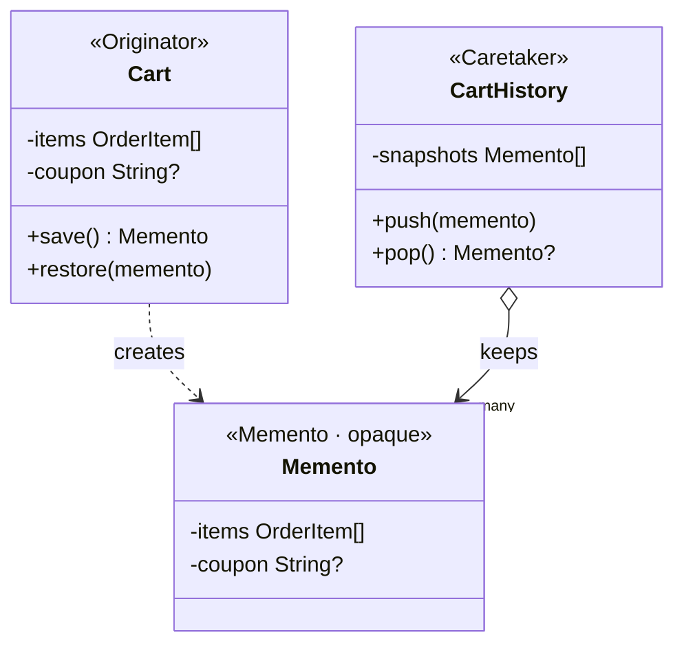

```swift
final class Cart {
    private var items: [OrderItem] = []
    private var coupon: String?

    struct Memento {                            // fields are fileprivate: only Cart reads them
        fileprivate let items: [OrderItem]
        fileprivate let coupon: String?
    }
    func save() -> Memento { Memento(items: items, coupon: coupon) }
    func restore(_ m: Memento) { items = m.items; coupon = m.coupon }
}

final class CartHistory {                       // stores snapshots, never looks inside
    private var snapshots: [Cart.Memento] = []
    func push(_ m: Cart.Memento) { snapshots.append(m) }
    func pop() -> Cart.Memento? { snapshots.popLast() }
}
```

**Command undo vs Memento.** Command undo knows the *inverse operation* (go back to the previous state). Memento stores a *copy* of the state and does not need to know what changed.

### 6.7 Visitor

**Idea.** Add new operations to a hierarchy of classes without changing those classes. Each element has `accept(visitor)` and calls back the right `visit` method (double dispatch).

**In the bookstore.** Cart entries are of different types (books, gift cards, bundles). New operations keep appearing: VAT calculation, JSON export, warehouse picking list. Each operation is one visitor; the entry classes stay untouched.

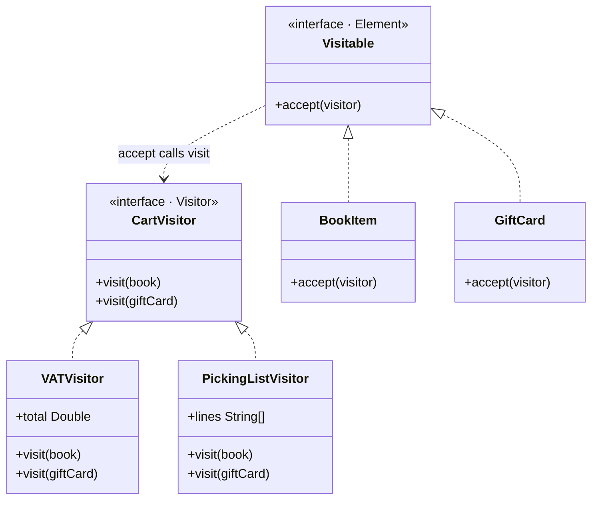

```swift
protocol CartVisitor { func visit(_ book: BookItem); func visit(_ card: GiftCard) }
protocol Visitable { func accept(_ visitor: CartVisitor) }

extension BookItem: Visitable { func accept(_ v: CartVisitor) { v.visit(self) } }
extension GiftCard: Visitable { func accept(_ v: CartVisitor) { v.visit(self) } }

final class VATVisitor: CartVisitor {
    private(set) var total = 0.0
    func visit(_ book: BookItem) { total += book.price * 0.08 }   // reduced VAT on books
    func visit(_ card: GiftCard) { }                              // no VAT on gift cards
}

let vat = VATVisitor()
cartEntries.forEach { $0.accept(vat) }
```

**Why it was not used.** The project has one kind of cart entry (`OrderItem`) and new behaviour is added with decorators. Visitor is worth it when the element types are stable and the operations change often.

### 6.8 Interpreter

**Idea.** Define a small grammar and represent each rule as a class; a sentence becomes a tree of objects that evaluates itself.

**In the bookstore.** A search language: `author:Martin AND price<500`. Each rule is a node in the expression tree.

**Close to the code.** `OrderConsole` already turns typed text (`queue ship`, `subscribe courier`) into actions. It is a very small command interpreter, written with a `switch` on words instead of an expression tree.

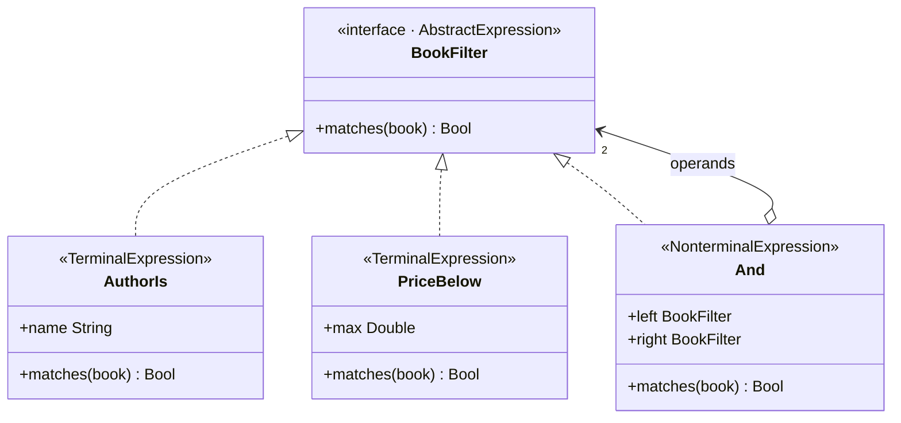

```swift
protocol BookFilter { func matches(_ book: Book) -> Bool }

struct AuthorIs: BookFilter { let name: String
    func matches(_ b: Book) -> Bool { b.author.contains(name) } }
struct PriceBelow: BookFilter { let max: Double
    func matches(_ b: Book) -> Bool { b.price < max } }
struct And: BookFilter { let left: BookFilter, right: BookFilter
    func matches(_ b: Book) -> Bool { left.matches(b) && right.matches(b) } }

// "author:Martin AND price<500" parsed into:
let query = And(left: AuthorIs(name: "Martin"), right: PriceBelow(max: 500))
let results = allBooks.filter(query.matches)     // Clean Code (450 MDL)
```

**Why it was not used.** A full grammar is heavy for a few fixed console commands; the `switch` in `OrderConsole` is simpler and enough.

### 6.9 Summary of all behavioral patterns

| Pattern | Problem it solves | Status in this lab |
|---|---|---|
| State | behaviour depends on the object's state | implemented: `OrderState` and 5 states |
| Command | requests as objects (queue, history, undo) | implemented: `OrderCommand`, `CommandProcessor` |
| Observer | one-to-many notification | implemented: `OrderEventPublisher` and 3 observers |
| Template Method | fixed algorithm, variable steps | partly: `OrderTransitionCommand.execute` / `perform` |
| Memento | save and restore state | partly: `stateBefore` used by undo |
| Interpreter | evaluate sentences of a small language | partly: `OrderConsole` commands (`switch`, no tree) |
| Strategy | interchangeable algorithms | theory: shipping cost |
| Chain of Responsibility | a request passed along handlers | theory: order checks |
| Iterator | traverse a collection without exposing it | theory: built into Swift (`Sequence`) |
| Mediator | many components talk through one centre | theory: checkout form |
| Visitor | new operations without changing classes | theory: VAT, picking list |

---

## 7. Conclusions

**What was harder than expected.**

- **Undo together with State.** The State pattern decides which transitions are allowed, but undo has to go *backwards* (Shipped → Packed), which no state allows. I solved it with a separate receiver method, `Order.revert(to:)`, used only by commands. It puts back the exact state object saved in `execute()` and still notifies the observers, with `isUndo = true`. This keeps the normal transition rules strict and makes the correction visible (the courier cancels its pickup).
- **Recording only what really happened.** A command can be rejected by the State. If it were added to the history anyway, undo would "undo" something that never happened. The base command therefore saves the old state only after `perform()` succeeds, and the invoker records only successful commands. A rejected command in the queue also stops the queue, so later commands do not run on a wrong assumption.
- **Name clash between labs.** Lab 1 already has a struct called `Order` (the Builder product). With both modules imported, the client had to write `BehavioralCore.Order`.

**What I would design differently.**

- `OrderState` is a protocol with one method per action and default rejections. A new action changes the protocol (one line plus a default). With many actions, a single `handle(_ action:)` method would be easier to extend.
- `OrderEventPublisher` keeps strong references to observers. In a long-running app, weak references or subscription tokens would avoid keeping removed screens alive.
- Undo bypasses the transition rules through `revert(to:)`. In a real warehouse some actions should not be undoable (a delivered parcel cannot be "un-delivered"). I would let each command declare whether it is undoable.
- Commands and observers are registered by name in `main.swift`. A small registry built from configuration would make new ones appear without touching the client at all.
